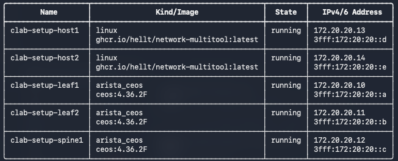
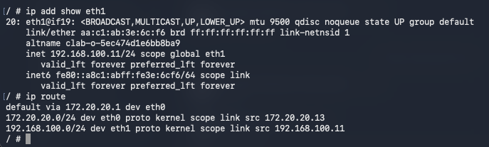
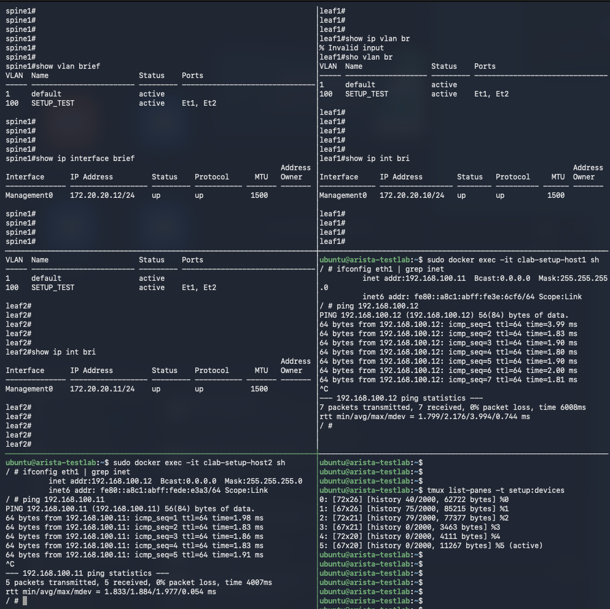

# 00 Lab Setup

## Purpose

This guide prepares an Ubuntu Linux environment for the networking labs in this repository. You will install Docker, Containerlab, and tmux; import Arista cEOS **4.36.2F**; and deploy a small network with one spine, two leaves, and two Linux hosts.

It does not matter where Ubuntu runs: a physical server, a local virtual machine, or a hosted virtual machine is suitable, provided it meets the requirements below and has internet access. Run the lab commands **inside Ubuntu**, rather than on the computer you use to connect to it.

The final connectivity test checks that the containers, interfaces, and software forwarding work. Later labs build on these setup skills to explore routed fabrics, VXLAN, and more advanced data centre networking. This virtual environment supports configuration and protocol learning; it cannot validate physical line-rate performance or hardware lossless forwarding for AI workloads.

This lab uses **Arista cEOS 4.36.2F**, with the Docker image tag **`ceos:4.36.2F`** in all commands and topology examples.

If you choose a different cEOS version, read that release's notes for compatibility requirements, supported features, known issues, and limitations before starting. Check compatibility with your Ubuntu, Docker, and Containerlab versions. Update **every reference** to the image filename and version tag in commands, topology files, and any later lab files to match your chosen release. Changing a Docker tag does not change the EOS software inside the image.

## 1 Minimum Requirements for This Guide

| Item | Minimum lab baseline |
| --- | --- |
| Operating system | Ubuntu Server 24.04 LTS, 64-bit |
| Architecture | x86_64 / amd64 |
| CPU | 2 CPU cores or vCPUs; 4 or more is preferable for faster startup |
| Memory | 32 GB RAM allocated to Ubuntu |
| Storage | 40 GB free disk space for images, extracted files, and lab data |
| Connectivity | Working DNS and internet access for package repositories, image registries, and downloads |
| Permissions | An Ubuntu account with `sudo` access |
| Switch software | Arista cEOS-lab 4.36.2F for x86_64 |
| Arista access | An Arista account with access to download cEOS-lab software |

These are the baseline allocations for this guide, rather than vendor-certified minimums. Larger topologies and different image versions may need more resources. Internet access alone is not sufficient: the Ubuntu system must also allow rootful Docker, privileged containers, and Linux virtual network interfaces. A normal Ubuntu VM is preferable to a restricted container or managed shell service.

Check the machine before proceeding:

```bash
uname -m
nproc
free -h
df -h /
cat /etc/os-release
```

The architecture should be `x86_64`. An ARM-based machine is outside the scope of this guide, even though some of the tools support ARM.

## 2 Prepare Ubuntu

All `bash` code blocks below run in the Ubuntu terminal unless another location is stated. Copy the commands without adding shell prompt characters.

```bash
sudo apt update
sudo apt install -y ca-certificates curl tmux git
```

Verify the supporting tools are installed:

```bash
curl --version
git --version
tmux -V
```

Each command should report a version without a `command not found` error.

Use a fresh Ubuntu environment. If Docker or another container runtime is already installed, review the [Docker prerequisites and conflicting packages](https://docs.docker.com/engine/install/ubuntu/#uninstall-old-versions) before continuing.

## 3 Install Docker Engine

Docker runs the switch and host containers. The following commands use Docker's official Ubuntu package repository, following the [Docker installation guide](https://docs.docker.com/engine/install/ubuntu/).

### Add the Docker repository

```bash
sudo install -m 0755 -d /etc/apt/keyrings
sudo curl -fsSL https://download.docker.com/linux/ubuntu/gpg -o /etc/apt/keyrings/docker.asc
sudo chmod a+r /etc/apt/keyrings/docker.asc

sudo tee /etc/apt/sources.list.d/docker.sources > /dev/null <<EOF
Types: deb
URIs: https://download.docker.com/linux/ubuntu
Suites: $(. /etc/os-release && echo "${UBUNTU_CODENAME:-$VERSION_CODENAME}")
Components: stable
Architectures: $(dpkg --print-architecture)
Signed-By: /etc/apt/keyrings/docker.asc
EOF

sudo apt update
```

### Install and verify Docker

```bash
sudo apt install -y docker-ce docker-ce-cli containerd.io docker-buildx-plugin docker-compose-plugin
sudo systemctl enable --now docker
sudo docker run --rm hello-world
sudo docker version
sudo systemctl is-active docker
```

The test should print `Hello from Docker!`, `docker version` should show both Client and Server details, and the service check should return `active`. This guide uses `sudo docker` throughout, so adding your account to the Docker group is optional.

## 4 Install Containerlab

Containerlab reads a topology file, starts the containers, and connects their data interfaces. Docker must already be working.

Download and run the installation script:

```bash
curl -fsSL https://get.containerlab.dev -o /tmp/containerlab-install.sh
sudo bash /tmp/containerlab-install.sh
containerlab version
```

Confirm the executable is available and its help opens:

```bash
command -v containerlab
containerlab generate --help
```

Expect an executable path and help text for the topology generator.

See the [Containerlab installation documentation](https://containerlab.dev/install/) for installation options and upgrades. This procedure installs Containerlab separately because Docker was installed in the previous section.

## 5 Create a Working Directory

From the root of your cloned repository, run:

```bash
mkdir -p 00_Lab_Setup
cd 00_Lab_Setup
```

If you are preparing the environment before cloning the repository, use a standalone directory instead:

```bash
mkdir -p ~/network-labs/00_Lab_Setup
cd ~/network-labs/00_Lab_Setup
```

Choose one location and continue there. Keep downloaded software outside the repository:

```bash
mkdir -p ~/lab-images
```

## 6 Download and Import Arista cEOS

### Obtain the image

1. Open [Arista Software Downloads](https://www.arista.com/en/support/software-download).
2. Sign in, or follow the account registration option if you do not have an account.
3. Locate the **cEOS-lab 64-bit image** for x86_64. Download the cEOS archive, rather than a vEOS virtual machine disk or an EOS upgrade image.
4. Select **4.36.2F** and read its release notes in the Arista download portal. If using another version, check its compatibility requirements and update all filenames and image references throughout the labs.
5. Place the archive in `~/lab-images/` on Ubuntu.

Download access depends on your Arista account permissions. If the image is unavailable, resolve access with Arista before proceeding. Follow the applicable download terms and keep the image out of the public repository. See [Containerlab's cEOS guidance](https://containerlab.dev/manual/kinds/ceos/) for image and runtime details.

If you downloaded the archive to another computer, transfer it to Ubuntu. Run this example **on that computer**, replacing the filename, username, and address:

```bash
scp /path/to/cEOS64-lab-4.36.2F.tar.xz ubuntu-user@ubuntu-address:~/lab-images/
```

### Import the archive

Back on Ubuntu, list the downloaded file:

```bash
ls -lh ~/lab-images/
```

The commands below assume the archive is named `cEOS64-lab-4.36.2F.tar.xz`. If your downloaded archive has a different name or extension, use its actual filename. Import the 4.36.2F archive with the matching tag `ceos:4.36.2F`.

```bash
sudo docker import ~/lab-images/cEOS64-lab-4.36.2F.tar.xz ceos:4.36.2F
sudo docker images ceos:4.36.2F
sudo docker image inspect ceos:4.36.2F --format '{{.RepoTags}}'
```

The image list should contain repository `ceos` with tag `4.36.2F`, and the inspection should list `ceos:4.36.2F`. A header with no matching image row means that tag is not present locally. [Docker's image listing reference](https://docs.docker.com/reference/cli/docker/image/ls/) explains the `docker images` command.

Use `docker import` for the original Arista filesystem archive. An archive created using `docker save` is restored with `docker load` instead. The tag is a local label; confirm the software actually running is 4.36.2F with `show version` after deployment.

## 7 Download the Linux Host Image

The two hosts use the same [Network Multitool image](https://github.com/hellt/Network-MultiTool), which includes utilities such as `ip`, `ping`, `tcpdump`, and `iperf3`.

```bash
sudo docker pull ghcr.io/hellt/network-multitool:latest
sudo docker images ghcr.io/hellt/network-multitool:latest
sudo docker image inspect ghcr.io/hellt/network-multitool:latest --format '{{.RepoTags}}'
```

The image list should show repository `ghcr.io/hellt/network-multitool` with tag `latest`. This confirms that the host image is available locally after the pull.

You download the image once; Containerlab creates two independent host containers from it. Do not start them manually with `docker run`.

For repeatable results, record the image digest before later updating the `latest` tag:

```bash
sudo docker image inspect ghcr.io/hellt/network-multitool:latest --format '{{json .RepoDigests}}'
```

### Optional transfer from another computer

If Ubuntu cannot reach the registry but another Docker-equipped computer can, run these commands **on the other computer**. Explicitly requesting `linux/amd64` also works when downloading from an ARM-based computer:

```bash
docker pull --platform linux/amd64 ghcr.io/hellt/network-multitool:latest
docker save -o multitool.tar ghcr.io/hellt/network-multitool:latest
scp multitool.tar ubuntu-user@ubuntu-address:~/lab-images/
```

Then run on Ubuntu:

```bash
sudo docker load -i ~/lab-images/multitool.tar
sudo docker images ghcr.io/hellt/network-multitool:latest
```

Confirm that the image appears with the same repository name and tag before deploying.

## 8 Create the Topology File

The topology contains five containers connected as follows:

```text
                         spine1
                    Ethernet1  Ethernet2
                        |          |
                    Ethernet1  Ethernet1
                       leaf1      leaf2
                    Ethernet2  Ethernet2
                        |          |
                       eth1       eth1
                       host1      host2
                 192.168.100.11  192.168.100.12
                       /24        /24
```

| Connection | First endpoint | Second endpoint |
| --- | --- | --- |
| Spine to leaf 1 | spine1 Ethernet1 | leaf1 Ethernet1 |
| Spine to leaf 2 | spine1 Ethernet2 | leaf2 Ethernet1 |
| Leaf 1 to host 1 | leaf1 Ethernet2 | host1 eth1 |
| Leaf 2 to host 2 | leaf2 Ethernet2 | host2 eth1 |

On the switches, topology interface `eth1` maps to EOS `Ethernet1`, and `eth2` maps to `Ethernet2`. Interface `eth0` is reserved for container management. Host traffic uses `eth1`.

### Option 1 Create the complete file directly

From your `00_Lab_Setup` directory, paste the complete block below. It creates `setup.clab.yml`. Repeating it overwrites that file, so save any edits first. YAML indentation uses spaces, not tabs.

```bash
cat > setup.clab.yml <<'EOF'
name: setup

topology:
  kinds:
    arista_ceos:
      image: ceos:4.36.2F

  nodes:
    spine1:
      kind: arista_ceos
    leaf1:
      kind: arista_ceos
    leaf2:
      kind: arista_ceos

    host1:
      kind: linux
      image: ghcr.io/hellt/network-multitool:latest
      exec:
        - ip link set eth1 up
        - ip addr replace 192.168.100.11/24 dev eth1

    host2:
      kind: linux
      image: ghcr.io/hellt/network-multitool:latest
      exec:
        - ip link set eth1 up
        - ip addr replace 192.168.100.12/24 dev eth1

  links:
    - endpoints: ["spine1:eth1", "leaf1:eth1"]
    - endpoints: ["spine1:eth2", "leaf2:eth1"]
    - endpoints: ["leaf1:eth2", "host1:eth1"]
    - endpoints: ["leaf2:eth2", "host2:eth1"]
EOF
```

`name` determines the container name prefix. `nodes` defines the devices, `links` defines the wiring, and each host's `exec` commands apply its data-interface configuration during deployment. Linux hosts use Containerlab's [linux kind](https://containerlab.dev/manual/kinds/linux/).

### Option 2 Generate the switch topology with a single command

You can also use Containerlab to generate the two-leaf, one-spine switch fabric:

```bash
containerlab generate --name setup --kind arista_ceos --nodes 2,1 --image arista_ceos=ceos:4.36.2F --file setup.clab.yml
```

`--nodes 2,1` means two leaves and one spine. `ceos:4.36.2F` matches the image imported earlier. Run this from `00_Lab_Setup` before deploying, and back up any existing `setup.clab.yml` first.

This command generates the switches and their links. To use it with the rest of this guide, rename `node1-1` to `leaf1`, `node1-2` to `leaf2`, and `node2-1` to `spine1` in the node definitions and link endpoints. Add the two host entries and use the four-link mapping from option 1 above. The complete five-device topology is shown there for reference. See the [Containerlab generate reference](https://containerlab.dev/cmd/generate/).

Before deploying either topology option, verify the file exists and review its image references:

```bash
ls -lh setup.clab.yml
grep -nE 'image:|ceos:' setup.clab.yml
```

The switch image reference should be `ceos:4.36.2F`, and the host image should be `ghcr.io/hellt/network-multitool:latest`. This is a content check, not full YAML validation; Containerlab reports topology errors during deployment.

## 9 Deploy the Lab

```bash
sudo containerlab deploy -t setup.clab.yml
sudo containerlab inspect -t setup.clab.yml
sudo docker ps --format 'table {{.Names}}\t{{.Status}}'
```

### Sample deployment output

The following sample shows the five lab containers running, with the switches using `ceos:4.36.2F`:



Management IPv4 and IPv6 addresses may differ between deployments. Use the container names below when connecting to devices.

The expected container names are:

```text
clab-setup-spine1
clab-setup-leaf1
clab-setup-leaf2
clab-setup-host1
clab-setup-host2
```

Allow a few minutes for cEOS to boot, particularly on a two-core machine. A running container does not necessarily mean EOS is ready to accept commands.

Open a switch CLI:

```bash
sudo docker exec -it clab-setup-spine1 Cli
```

At the EOS prompt:

```text
enable
show version
show interfaces status
show lldp neighbors
```

`show version` should report EOS **4.36.2F**. Repeat this check on both leaves. If a switch reports another version, check which archive was imported and which image the topology uses; renaming the image tag is not an upgrade.

Use `exit` to leave the EOS CLI. You can also check all three versions from Ubuntu:

```bash
sudo docker exec clab-setup-spine1 Cli -c 'show version'
sudo docker exec clab-setup-leaf1 Cli -c 'show version'
sudo docker exec clab-setup-leaf2 Cli -c 'show version'
```

Run those commands from an Ubuntu shell, rather than from inside EOS.

Open a Linux host shell with:

```bash
sudo docker exec -it clab-setup-host1 sh
```

Inside the host, confirm `eth1` has `192.168.100.11/24` and a connected route to `192.168.100.0/24`:

```bash
ip addr show eth1
ip route
exit
```

### Sample host network output

The following sample shows host1 with `192.168.100.11/24` on `eth1` and a connected route to `192.168.100.0/24`. The default route through `eth0` belongs to the container management network. Management addresses may differ between deployments.



Check host2 from Ubuntu as well; expect `192.168.100.12/24` on its `eth1`:

```bash
sudo docker exec clab-setup-host2 ip addr show eth1
sudo docker exec clab-setup-host2 ip route
```

## 10 Verify Data Connectivity

For this setup check, all four switch links use **access VLAN 100**. This gives the two hosts a single Layer 2 path through the spine. It is a temporary verification configuration; later routed fabric and VXLAN labs will provide their own configurations.

### Configure spine1

Run in Ubuntu:

```bash
sudo docker exec -it clab-setup-spine1 Cli
```

Paste into the EOS CLI:

```text
enable
configure terminal
vlan 100
   name SETUP_TEST
interface Ethernet1
   description TO_LEAF1
   switchport
   switchport mode access
   switchport access vlan 100
   no shutdown
interface Ethernet2
   description TO_LEAF2
   switchport
   switchport mode access
   switchport access vlan 100
   no shutdown
end
write memory
exit
```

### Configure leaf1

Run in Ubuntu:

```bash
sudo docker exec -it clab-setup-leaf1 Cli
```

Paste into the EOS CLI:

```text
enable
configure terminal
vlan 100
   name SETUP_TEST
interface Ethernet1
   description TO_SPINE1
   switchport
   switchport mode access
   switchport access vlan 100
   no shutdown
interface Ethernet2
   description TO_HOST1
   switchport
   switchport mode access
   switchport access vlan 100
   no shutdown
end
write memory
exit
```

### Configure leaf2

Run in Ubuntu:

```bash
sudo docker exec -it clab-setup-leaf2 Cli
```

Paste into the EOS CLI:

```text
enable
configure terminal
vlan 100
   name SETUP_TEST
interface Ethernet1
   description TO_SPINE1
   switchport
   switchport mode access
   switchport access vlan 100
   no shutdown
interface Ethernet2
   description TO_HOST2
   switchport
   switchport mode access
   switchport access vlan 100
   no shutdown
end
write memory
exit
```

### Test both directions

Run from Ubuntu after the interfaces and spanning tree have converged:

```bash
sudo docker exec clab-setup-host1 ping -c 4 192.168.100.12
sudo docker exec clab-setup-host2 ping -c 4 192.168.100.11
```

Both tests should receive replies. An initial packet may be lost during address resolution. Both hosts are in the same subnet, so no default gateway is needed for this test. Pinging management addresses does not verify this data path.

On each switch, inspect:

```text
show interfaces status
show lldp neighbors
show vlan
show spanning-tree vlan 100
show mac address-table vlan 100
```

Switch-to-switch LLDP neighbors should match the wiring table. The Linux hosts may not advertise LLDP. After the ping test, host MAC addresses should be learned on the appropriate local and upstream ports.

## 11 Access All Devices with tmux

tmux keeps several terminal panes inside one terminal window. It was installed in section 2. Confirm it is available:

```bash
tmux -V
```

The following block creates a session with five device panes and one Ubuntu shell pane. Run it from your Ubuntu shell **outside an existing tmux session**. Use a reasonably large terminal window.

```bash
sudo -v
tmux new-session -d -s setup -n devices
tmux split-window -h -t setup:devices
tmux select-layout -t setup:devices tiled
tmux split-window -v -t setup:devices
tmux select-layout -t setup:devices tiled
tmux split-window -v -t setup:devices
tmux select-layout -t setup:devices tiled
tmux split-window -v -t setup:devices
tmux select-layout -t setup:devices tiled
tmux split-window -v -t setup:devices
tmux select-layout -t setup:devices tiled
tmux attach-session -t setup
```

After attaching, verify the session from the Ubuntu shell pane:

```bash
tmux list-sessions
tmux list-panes -t setup:devices
```

Expect session `setup` and six pane entries.

In five separate panes, run one command per pane. Keep the sixth pane as an Ubuntu shell for deployment and inspection commands.

```bash
sudo docker exec -it clab-setup-spine1 Cli
```

```bash
sudo docker exec -it clab-setup-leaf1 Cli
```

```bash
sudo docker exec -it clab-setup-leaf2 Cli
```

```bash
sudo docker exec -it clab-setup-host1 sh
```

```bash
sudo docker exec -it clab-setup-host2 sh
```

Each pane may ask for your Ubuntu sudo password. On a switch, enter `enable` if the prompt ends in `>`.

Press `Ctrl+b`, release both keys, then press the next key:

| Keys | Action |
| --- | --- |
| `Ctrl+b`, then an arrow key | Move to the pane in that direction |
| `Ctrl+b`, then `o` | Move to the next pane |
| `Ctrl+b`, then `q`, then a displayed number | Select a pane by number |
| `Ctrl+b`, then `z` | Enlarge the active pane; repeat to restore the layout |
| `Ctrl+b`, then `Space` | Cycle pane layouts |
| `Ctrl+b`, then `d` | Detach while keeping the session running |

Reconnect after detaching or losing your SSH connection:

```bash
tmux attach-session -t setup
```

If `setup` already exists, reattach instead of repeating the creation block. See the [tmux Getting Started guide](https://github.com/tmux/tmux/wiki/Getting-Started) for more controls.

### Completed lab with six terminal panes

The screenshot below shows the completed setup in one tmux window: three switch CLIs, two host shells, and an Ubuntu shell. The switches show VLAN 100 (`SETUP_TEST`) active on Ethernet1 and Ethernet2, both hosts show successful ping results with 0% packet loss, and `tmux list-panes` lists all six panes.



## 12 Save and Stop the Lab

Save switch changes with `write memory` in each EOS CLI. For this topology, Containerlab stores switch startup configurations under `clab-setup/<switch-name>/flash/startup-config`.

To retain separate copies, run from `00_Lab_Setup`. The `-p 15` option starts the EOS CLI in privileged mode, equivalent to entering `enable` before `show running-config`. Ubuntu's `sudo` does not itself select the EOS privilege level. Containerlab also uses this option for its [cEOS configuration save command](https://containerlab.dev/cmd/save/).

```bash
mkdir -p configs
sudo docker exec clab-setup-spine1 Cli -p 15 -c 'show running-config' > configs/spine1.cfg
sudo docker exec clab-setup-leaf1 Cli -p 15 -c 'show running-config' > configs/leaf1.cfg
sudo docker exec clab-setup-leaf2 Cli -p 15 -c 'show running-config' > configs/leaf2.cfg
```

Verify that the exports contain configurations rather than CLI error messages:

```bash
head -n 15 configs/spine1.cfg
head -n 15 configs/leaf1.cfg
head -n 15 configs/leaf2.cfg
```

If you previously ran the commands without privileged mode, rerun the corrected exports above to replace those files before using them for restoration.

To remove the containers while retaining the generated lab directory:

```bash
sudo containerlab destroy -t setup.clab.yml
```

To deploy again:

```bash
sudo containerlab deploy -t setup.clab.yml
```

Existing saved switch configurations in the retained directory can be reused. Host addressing is reapplied from the YAML; other changes made inside host containers are not preserved. Removing the generated lab directory discards the switch state it contains, so keep configuration backups you need.

When finished with the terminal panes, run from a separate Ubuntu shell:

```bash
tmux kill-session -t setup
```

Ending tmux does not stop the lab containers. Stopping the lab is a separate Containerlab operation.

## 13 Redeploy Lab from Saved Configs

You can restore each switch from the corresponding running-config backup created in section 12. The recommended approach is to reference those files in the topology so Containerlab loads them as startup configurations when rebuilding the lab.

Run the Ubuntu commands below from `00_Lab_Setup`. Use backups from cEOS **4.36.2F** with this lab. If restoring to another release, review its release notes and configuration compatibility first, and update the image references as explained earlier.

### Check the backup files

```bash
ls -lh configs/spine1.cfg configs/leaf1.cfg configs/leaf2.cfg
head -n 15 configs/spine1.cfg
head -n 15 configs/leaf1.cfg
head -n 15 configs/leaf2.cfg
```

All three files should exist, have nonzero sizes, and contain EOS configuration text. Check the hostname and interface configuration to ensure each file belongs to the intended device. Resolve any empty files or command-error output before proceeding.

### Reference each backup in the topology

In `setup.clab.yml`, add a `startup-config` line to each existing switch definition under `topology.nodes`:

```yaml
    spine1:
      kind: arista_ceos
      startup-config: configs/spine1.cfg
    leaf1:
      kind: arista_ceos
      startup-config: configs/leaf1.cfg
    leaf2:
      kind: arista_ceos
      startup-config: configs/leaf2.cfg
```

Keep the existing cEOS image setting `ceos:4.36.2F`, both host definitions, and all four links. Edit the existing switch entries rather than adding duplicate node names. These configuration paths are relative to the topology file. See [Containerlab's cEOS startup configuration documentation](https://containerlab.dev/manual/kinds/ceos/#user-defined-config).

### Rebuild using the saved files

The following command **destroys and recreates the lab and its generated runtime directory**. Save any newer changes first. Keep the backup files in `configs/`, outside the generated `clab-setup/` directory.

```bash
sudo containerlab deploy -t setup.clab.yml --reconfigure
sudo containerlab inspect -t setup.clab.yml
```

`--reconfigure` ensures the referenced backups are used instead of older startup configurations retained in the generated lab directory. See the [Containerlab reconfigure reference](https://containerlab.dev/cmd/deploy/#reconfigure).

The switches load their respective saved configurations during boot. The hosts receive their addressing again from the topology's `exec` commands.

### Verify the restored lab

Allow cEOS to finish booting, then inspect each restored configuration:

```bash
sudo docker exec clab-setup-spine1 Cli -p 15 -c 'show running-config'
sudo docker exec clab-setup-leaf1 Cli -p 15 -c 'show running-config'
sudo docker exec clab-setup-leaf2 Cli -p 15 -c 'show running-config'
sudo docker exec clab-setup-spine1 Cli -c 'show version'
sudo docker exec clab-setup-leaf1 Cli -c 'show version'
sudo docker exec clab-setup-leaf2 Cli -c 'show version'
sudo docker exec clab-setup-host1 ping -c 4 192.168.100.12
sudo docker exec clab-setup-host2 ping -c 4 192.168.100.11
```

Confirm the expected interfaces and VLAN settings have returned, all switches report 4.36.2F, and both ping tests receive replies when restoring the section 10 setup configuration. If the backups come from a later lab, use that lab's addressing and verification tests instead.

### Alternative Copy a backup to a running device

If the lab is already running and you want to restore a switch without rebuilding the containers, copy each backup into its corresponding switch's flash directory:

```bash
sudo docker cp configs/spine1.cfg clab-setup-spine1:/mnt/flash/restore.cfg
sudo docker cp configs/leaf1.cfg clab-setup-leaf1:/mnt/flash/restore.cfg
sudo docker cp configs/leaf2.cfg clab-setup-leaf2:/mnt/flash/restore.cfg
```

Copying the file does not apply it. For example, open spine1:

```bash
sudo docker exec -it clab-setup-spine1 Cli
```

In the EOS CLI, verify the file, replace the active configuration, and save it:

```text
enable
dir flash:
configure replace flash:restore.cfg
show running-config
write memory
exit
```

`configure replace` replaces the active configuration, including settings absent from the backup. Check its output for errors before saving; if it fails, resolve the errors rather than saving an unsuccessful restore. See [Arista's configure replace reference](https://www.arista.com/en/um-eos/eos-session-management-commands).

Repeat the CLI procedure on leaf1 and leaf2, connecting with `sudo docker exec -it clab-setup-leaf1 Cli` and `sudo docker exec -it clab-setup-leaf2 Cli`. Each device has its own `restore.cfg` copied from its matching backup. Run the verification tests above after completing the restores.

## 14 Troubleshooting

| Symptom | Check |
| --- | --- |
| Docker cannot connect to its daemon | Run `sudo systemctl status docker` and confirm you used `sudo docker`. |
| Image download fails | Check DNS, internet access, proxy settings, and access to the registry. Use the save/load transfer method if necessary. |
| Containerlab cannot find `ceos:4.36.2F` | Run `sudo docker image inspect ceos:4.36.2F`; the YAML and imported image tag must match. |
| cEOS is slow or its CLI is unavailable | Allow boot time, check `free -h` and `sudo docker stats --no-stream`, and inspect `sudo docker logs clab-setup-spine1`. |
| Older cEOS fails on modern Ubuntu | Check the cgroups compatibility notes in the linked cEOS documentation; use a compatible image release. |
| Hosts cannot ping each other | Check host `eth1` addressing, link mapping, VLAN 100 membership, and spanning-tree forwarding state. |
| Topology parsing fails | Check YAML spaces, indentation, quotes, and spelling. Read the first error from the deploy command. |
| tmux says the session already exists | Run `tmux attach-session -t setup`. |

## 15 Ready for the Following Labs

Before moving on, confirm that:

- Docker passes the `hello-world` test.
- Containerlab reports its installed version.
- `sudo docker images` lists `ceos:4.36.2F` and the Linux host image.
- `show version` reports 4.36.2F on all three switches, or your chosen release with all references and compatibility checks updated.
- All five containers start and their CLIs or shells are accessible.
- The two hosts can ping each other across the switch data interfaces.
- You can switch tmux panes, detach, and reconnect.
- You have saved any configurations you want to retain.

The installation, image handling, YAML structure, deployment commands, and tmux workflow are useful for all following labs. Each lab will supply its own topology, interface map, addressing, and configuration. Install the tools once, then reuse them; deploy the next lab from its own directory and stop unused labs to free resources.

The simple VLAN configuration in this setup is not a prerequisite configuration to paste into later labs. Follow each lab's starting instructions so that setup-test settings do not interfere with routed or VXLAN exercises.

## 16 Files to Keep in GitHub

Keep the README, topology files, and reviewed configuration files in the repository. Keep downloaded images, generated runtime state, and credentials out of Git.

The following patterns can be added to the repository-root `.gitignore`:

```gitignore
# Containerlab runtime directories and generated inventory
**/clab-*/
**/.clab-*

# Downloaded image archives
*.tar
*.tar.xz
*.tar.gz
*.tgz
```

Review configuration exports before committing them because they may contain credentials. Ignore rules apply to untracked files; they do not remove files that Git already tracks.
