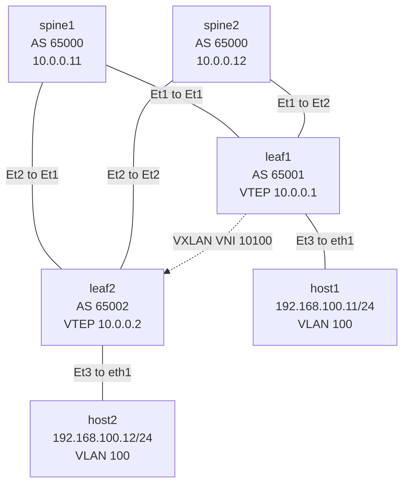
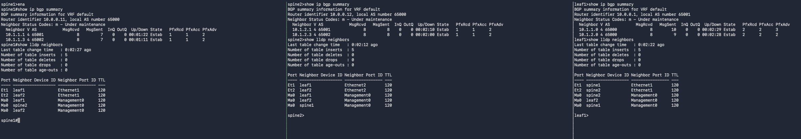
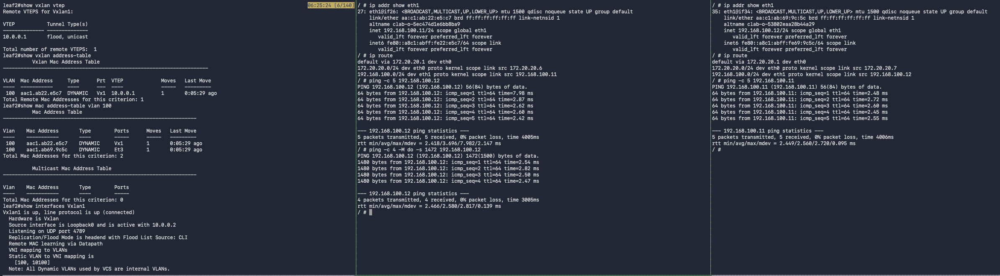
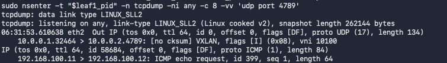

# 01 Lab 01 VXLAN

## Before You Begin

If you have not prepared your Ubuntu lab environment, complete [00 Lab Setup](../00_Lab_Setup/README.md) first. This lab assumes Docker, Containerlab, tmux, the Linux host image, and the Arista cEOS image are already installed and available.

This lab uses **Arista cEOS 4.36.2F**, tagged **`ceos:4.36.2F`**. If you choose another release, read its release notes for compatibility requirements and known issues, then update every image reference in commands and topology files to your chosen version. Use the resource baseline in Lab 00; four switch containers may take longer to boot than the setup lab.

## Purpose

Build a two-spine, two-leaf fabric and connect two Linux hosts across a VXLAN tunnel. Host1 attaches to leaf1 and host2 attaches to leaf2, placing them on opposite sides of the fabric. There is no direct leaf-to-leaf link.

Both hosts use **VLAN 100** and subnet **192.168.100.0/24**. The leaf switches map VLAN 100 to **VNI 10100**. An eBGP underlay provides reachability between their loopback addresses, which act as VXLAN Tunnel Endpoints (VTEPs). The spines route the outer packets; they do not extend VLAN 100.

This first VXLAN lab uses static head-end replication and data-plane MAC learning. EVPN is reserved for a later lab. No host default gateway or VLAN 100 SVI is required because the hosts communicate within one subnet. This virtual lab teaches forwarding and configuration behaviour, rather than physical bandwidth or lossless AI networking performance.

## Topology



Each leaf connects to **both** spines. The dotted connection is the logical VXLAN tunnel, not a physical leaf-to-leaf cable. GitHub renders the Mermaid diagram above; the link table below also provides the complete wiring map.

| Link | First endpoint | Second endpoint |
| --- | --- | --- |
| 1 | spine1 Ethernet1 | leaf1 Ethernet1 |
| 2 | spine1 Ethernet2 | leaf2 Ethernet1 |
| 3 | spine2 Ethernet1 | leaf1 Ethernet2 |
| 4 | spine2 Ethernet2 | leaf2 Ethernet2 |
| 5 | leaf1 Ethernet3 | host1 eth1 |
| 6 | leaf2 Ethernet3 | host2 eth1 |

Containerlab `eth1`, `eth2`, and `eth3` map to EOS `Ethernet1`, `Ethernet2`, and `Ethernet3`. Container `eth0` is the management connection, separate from the lab data path.

## Addressing Plan

| Device | AS | Loopback0 | Ethernet1 | Ethernet2 | Ethernet3 |
| --- | --- | --- | --- | --- | --- |
| spine1 | 65000 | 10.0.0.11/32 | 10.1.1.0/31 | 10.1.1.2/31 | Unused |
| spine2 | 65000 | 10.0.0.12/32 | 10.1.2.0/31 | 10.1.2.2/31 | Unused |
| leaf1 | 65001 | 10.0.0.1/32 | 10.1.1.1/31 | 10.1.2.1/31 | VLAN 100 access |
| leaf2 | 65002 | 10.0.0.2/32 | 10.1.1.3/31 | 10.1.2.3/31 | VLAN 100 access |

| Host | Data interface | Address | Attached switch |
| --- | --- | --- | --- |
| host1 | eth1 | 192.168.100.11/24 | leaf1 Ethernet3 |
| host2 | eth1 | 192.168.100.12/24 | leaf2 Ethernet3 |

## 1 Verify the Environment

Run all `bash` blocks in Ubuntu unless otherwise stated. EOS command blocks run inside the named switch CLI. Do not paste the setup lab's VLAN-only configuration into this fabric.

### Verification

```bash
uname -m
free -h
df -h /
sudo systemctl is-active docker
containerlab version
tmux -V
sudo docker images ceos:4.36.2F
sudo docker images ghcr.io/hellt/network-multitool:latest
```

Expect `x86_64`, an active Docker service, tool versions, and matching image rows. If anything is missing, return to Lab 00. Stop any unused setup-lab containers using that lab's shutdown instructions to free resources.

Install the Ubuntu packet capture utility for the verification exercise:

```bash
sudo apt update
sudo apt install -y tcpdump
```

### Verification

```bash
tcpdump --version
command -v nsenter
```

Expect a tcpdump version and a path to `nsenter`, supplied by Ubuntu's `util-linux` package.

## 2 Create the Lab Directory

From your cloned repository root:

```bash
mkdir -p 01_Lab01_VXLAN
cd 01_Lab01_VXLAN
mkdir -p "config_backup"
```

Use `config_backup` as the configuration backup directory for this and all following labs. Run subsequent Ubuntu commands from this lab directory.

### Verification

```bash
pwd
ls -ld "config_backup"
```

The working path should end in `01_Lab01_VXLAN`, and the backup directory should exist.

## 3 Create the Topology File

Paste this complete block to create `Lab01_VXLAN_Topology.yml`. It defines six devices and six links. Hosts use a 1500-byte data MTU; the switch underlay will use a larger IP MTU to accommodate VXLAN overhead.

```bash
cat > Lab01_VXLAN_Topology.yml <<'EOF'
name: vxlan01

topology:
  kinds:
    arista_ceos:
      image: ceos:4.36.2F

  nodes:
    spine1:
      kind: arista_ceos
    spine2:
      kind: arista_ceos
    leaf1:
      kind: arista_ceos
    leaf2:
      kind: arista_ceos

    host1:
      kind: linux
      image: ghcr.io/hellt/network-multitool:latest
      exec:
        - ip link set eth1 mtu 1500
        - ip link set eth1 up
        - ip addr replace 192.168.100.11/24 dev eth1

    host2:
      kind: linux
      image: ghcr.io/hellt/network-multitool:latest
      exec:
        - ip link set eth1 mtu 1500
        - ip link set eth1 up
        - ip addr replace 192.168.100.12/24 dev eth1

  links:
    - endpoints: ["spine1:eth1", "leaf1:eth1"]
    - endpoints: ["spine1:eth2", "leaf2:eth1"]
    - endpoints: ["spine2:eth1", "leaf1:eth2"]
    - endpoints: ["spine2:eth2", "leaf2:eth2"]
    - endpoints: ["leaf1:eth3", "host1:eth1"]
    - endpoints: ["leaf2:eth3", "host2:eth1"]
EOF
```

### Verification

```bash
ls -lh Lab01_VXLAN_Topology.yml
cat Lab01_VXLAN_Topology.yml
```

Check the image tag, six node entries, six links, and host addresses against the tables above. The next step parses and deploys the YAML; correct any errors it reports before configuring devices.

## 4 Deploy the Topology

### Check for existing labs

Before deploying, list all existing Containerlab labs:

```bash
sudo containerlab inspect --all
```

Review the lab names and topology paths. If any labs are listed, save any configurations you need, then stop and clean up each previous lab using its topology file. For example, if `dc1` is listed, replace the example path below with the path shown by inspection:

```bash
sudo containerlab destroy -t /path/to/dc1.clab.yml --cleanup
```

If the Lab 00 setup topology is still running, its command from this directory is:

```bash
sudo containerlab destroy -t ../00_Lab_Setup/setup.clab.yml --cleanup
```

Run only the cleanup commands for labs that are present. `--cleanup` removes that lab's generated runtime directory, including configurations stored there; keep required backups outside it. Use the matching topology path rather than relying on `destroy --name dc1` alone, which can still require topology-file resolution. See the [Containerlab destroy reference](https://containerlab.dev/cmd/destroy/).

### Alternative Stop all labs and start fresh

You can also use `destroy --all` to stop and remove all deployed Containerlab labs in one command. Add `--cleanup` to remove their generated runtime directories as well:

```bash
sudo containerlab destroy --all --cleanup
```

Review and confirm the prompt. This affects every Containerlab lab on the Ubuntu host, so save any configurations you need outside the generated lab directories first. Downloaded Docker images and separately saved `config_backup` folders remain available.

### Verification before deployment

```bash
sudo containerlab inspect --all
```

Continue when inspection reports no deployed labs. Repeat the matching cleanup operation if a previous lab is still listed.

### Deploy this lab

```bash
sudo containerlab deploy -t Lab01_VXLAN_Topology.yml
```

### Verification

```bash
sudo containerlab inspect -t Lab01_VXLAN_Topology.yml
sudo docker ps --filter name=clab-vxlan01- --format 'table {{.Names}}\t{{.Image}}\t{{.Status}}'
```

Expect four cEOS containers and two Linux containers:

```text
clab-vxlan01-spine1
clab-vxlan01-spine2
clab-vxlan01-leaf1
clab-vxlan01-leaf2
clab-vxlan01-host1
clab-vxlan01-host2
```

Wait for EOS to boot. Container state `running` alone does not confirm CLI readiness. Verify all four versions:

```bash
for device in spine1 spine2 leaf1 leaf2; do
  printf '\nDevice: %s\n' "$device"
  sudo docker exec "clab-vxlan01-$device" Cli -p 15 -c 'show version'
done
```

Each switch should report **4.36.2F**. If a CLI is unavailable, allow more time and check `sudo docker logs clab-vxlan01-spine1`, substituting the affected device name.

## 5 Open the Devices in tmux

This script creates **seven terminal panes in one tmux window**: four switch CLIs, two host shells, and one Ubuntu shell. Each device pane starts its `docker exec` command automatically. The Ubuntu pane is used for lab control commands and packet captures. The script enables mouse support automatically, so you can click a pane to select it and drag its borders to resize it.

Run this from `01_Lab01_VXLAN`, outside an existing tmux session, after all six containers are ready. Use a large terminal window. Create the script below, or use the supplied `Lab01_Open_Terminals.sh` file:

```bash
cat > Lab01_Open_Terminals.sh <<'EOF'
#!/bin/bash
set -e

if [[ -n "${TMUX:-}" ]]; then
  printf 'Run this script from an Ubuntu terminal outside tmux.\n'
  exit 1
fi

session="vxlan01"
lab_dir=$(cd -- "$(dirname -- "${BASH_SOURCE[0]}")" && pwd)

if tmux has-session -t "$session" 2>/dev/null; then
  tmux set -g mouse on
  tmux attach-session -t "$session"
  exit 0
fi

sudo -v

tmux new-session -d -s "$session" -n devices -c "$lab_dir" \
  'sudo docker exec -it clab-vxlan01-spine1 Cli'

for device in spine2 leaf1 leaf2; do
  tmux split-window -t "$session:devices" -c "$lab_dir" \
    "sudo docker exec -it clab-vxlan01-$device Cli"
  tmux select-layout -t "$session:devices" tiled
done

for device in host1 host2; do
  tmux split-window -t "$session:devices" -c "$lab_dir" \
    "sudo docker exec -it clab-vxlan01-$device sh"
  tmux select-layout -t "$session:devices" tiled
done

# The seventh pane is the Ubuntu shell for lab commands and captures.
tmux split-window -t "$session:devices" -c "$lab_dir" 'bash'
tmux select-layout -t "$session:devices" tiled
tmux set -g mouse on
tmux attach-session -t "$session"
EOF

bash Lab01_Open_Terminals.sh
```

If a device pane asks for your Ubuntu sudo password, enter it there to complete the connection. On switches, enter `enable` when you need privileged commands. If your account already has Docker access, you may remove `sudo` from the script's `docker exec` commands.

The script reattaches if session `vxlan01` already exists. If you still have the earlier eight-pane layout, detach and run `tmux kill-session -t vxlan01` from an Ubuntu terminal before launching this script to create the new layout. This closes the old terminals and leaves the lab containers running.

| Keys | Action |
| --- | --- |
| Click inside a pane | Select that pane |
| Drag a pane border | Resize the panes |
| `Ctrl+b`, then an arrow key | Move between panes using the keyboard |
| `Ctrl+b`, then `q`, then a number | Select the numbered pane |
| `Ctrl+b`, then `z` | Zoom the current pane; repeat to restore |
| `Ctrl+b`, then `d` | Detach without ending the session |

Reconnect using `tmux attach-session -t vxlan01`, or run the script again from outside tmux.

### Verification

In the Ubuntu pane:

```bash
tmux list-sessions
tmux list-panes -t vxlan01:devices
tmux list-panes -t vxlan01:devices -F '#{pane_id}' | wc -l
tmux show-options -g mouse
```

Expect session `vxlan01`, seven pane entries, a count of `7`, and `mouse on`. Confirm that four panes show switch prompts, two show Linux host shell prompts, and one shows the Ubuntu shell. In each switch pane, run:

```text
enable
show hostname
show lldp neighbors
```

Confirm the device identity before pasting a configuration. Each switch should see its two switch neighbors from the link table. Linux hosts do not necessarily advertise LLDP. See the [tmux guide](https://github.com/tmux/tmux/wiki/Getting-Started) for additional controls.

## 6 Configure the Underlay on spine1

In the **spine1 EOS pane**:

```text
enable
configure terminal
hostname spine1
ip routing
interface Loopback0
   ip address 10.0.0.11/32
interface Ethernet1
   description TO_LEAF1_ETHERNET1
   no switchport
   mtu 9000
   ip address 10.1.1.0/31
   no shutdown
interface Ethernet2
   description TO_LEAF2_ETHERNET1
   no switchport
   mtu 9000
   ip address 10.1.1.2/31
   no shutdown
router bgp 65000
   router-id 10.0.0.11
   maximum-paths 2
   neighbor 10.1.1.1 remote-as 65001
   neighbor 10.1.1.3 remote-as 65002
   network 10.0.0.11/32
end
```

### Verification

```text
show ip interface brief
show interfaces Ethernet1
show running-config interfaces Ethernet1
show running-config section router bgp
```

Check both routed interface addresses, Loopback0, and the two configured BGP neighbors. BGP will establish after the leaves are configured. The routed IP MTU should be 9000. See [Arista's MTU reference](https://www.arista.com/en/um-eos/eos-data-transfer) for the interface `mtu` command.

## 7 Configure the Underlay on spine2

In the **spine2 EOS pane**:

```text
enable
configure terminal
hostname spine2
ip routing
interface Loopback0
   ip address 10.0.0.12/32
interface Ethernet1
   description TO_LEAF1_ETHERNET2
   no switchport
   mtu 9000
   ip address 10.1.2.0/31
   no shutdown
interface Ethernet2
   description TO_LEAF2_ETHERNET2
   no switchport
   mtu 9000
   ip address 10.1.2.2/31
   no shutdown
router bgp 65000
   router-id 10.0.0.12
   maximum-paths 2
   neighbor 10.1.2.1 remote-as 65001
   neighbor 10.1.2.3 remote-as 65002
   network 10.0.0.12/32
end
```

### Verification

```text
show ip interface brief
show interfaces Ethernet2
show running-config interfaces Ethernet2
show running-config section router bgp
```

Confirm the spine2 addresses and neighbors against the addressing plan. Neither spine needs VLAN 100 or a Vxlan1 interface.

## 8 Configure the Underlay on leaf1

In the **leaf1 EOS pane**:

```text
enable
configure terminal
hostname leaf1
ip routing
interface Loopback0
   ip address 10.0.0.1/32
interface Ethernet1
   description TO_SPINE1_ETHERNET1
   no switchport
   mtu 9000
   ip address 10.1.1.1/31
   no shutdown
interface Ethernet2
   description TO_SPINE2_ETHERNET1
   no switchport
   mtu 9000
   ip address 10.1.2.1/31
   no shutdown
router bgp 65001
   router-id 10.0.0.1
   maximum-paths 2
   neighbor 10.1.1.0 remote-as 65000
   neighbor 10.1.2.0 remote-as 65000
   network 10.0.0.1/32
end
```

### Verification

```text
show ip interface brief
ping 10.1.1.0
ping 10.1.2.0
show ip bgp summary
```

Both directly connected spine addresses should reply. The two BGP sessions should establish after convergence. In the summary, a numeric received-prefix count in the final column indicates an established session; `Idle`, `Active`, or `Connect` indicates a problem or an incomplete startup.

## 9 Configure the Underlay on leaf2

In the **leaf2 EOS pane**:

```text
enable
configure terminal
hostname leaf2
ip routing
interface Loopback0
   ip address 10.0.0.2/32
interface Ethernet1
   description TO_SPINE1_ETHERNET2
   no switchport
   mtu 9000
   ip address 10.1.1.3/31
   no shutdown
interface Ethernet2
   description TO_SPINE2_ETHERNET2
   no switchport
   mtu 9000
   ip address 10.1.2.3/31
   no shutdown
router bgp 65002
   router-id 10.0.0.2
   maximum-paths 2
   neighbor 10.1.1.2 remote-as 65000
   neighbor 10.1.2.2 remote-as 65000
   network 10.0.0.2/32
end
```

### Verification

```text
show ip interface brief
ping 10.1.1.2
ping 10.1.2.2
show ip bgp summary
```

Both spine addresses should reply, and leaf2 should have two established BGP sessions.

## 10 Verify the Complete Underlay

The VTEP loopbacks must be reachable before adding VXLAN. Each leaf advertises its own loopback to both spines; each spine advertises it onward to the other leaf.

### Verification

On **each of the four switches**:

```text
show ip bgp summary
show ip route bgp
```

Each switch should have two established neighbors. On **leaf1**:

```text
show ip route 10.0.0.2
ping 10.0.0.2 source Loopback0
```

Expect two next hops for the remote VTEP: `10.1.1.0` and `10.1.2.0`. On **leaf2**:

```text
show ip route 10.0.0.1
ping 10.0.0.1 source Loopback0
```

Expect next hops `10.1.1.2` and `10.1.2.2`. Both loopback-sourced ping tests must succeed. If only one next hop appears, check both uplinks, BGP sessions, and `maximum-paths 2` before proceeding.

### Sample underlay verification output

The screenshot below shows established BGP sessions and LLDP neighbors on spine1, spine2, and leaf1 before configuring VXLAN. Compare the Ethernet uplink neighbors with the topology table; LLDP entries on Management0 belong to the shared management network. Complete the same checks on leaf2 and verify the VTEP loopback routes and pings above before continuing.



## 11 Configure VLAN 100 and the VXLAN Tunnel

Each leaf encapsulates local host Ethernet frames into VXLAN packets addressed to the remote leaf's VTEP. The static flood list lets address-resolution and other flooded traffic reach the other leaf. Both leaves must use the same VLAN-to-VNI mapping. See [Arista's VXLAN configuration reference](https://www.arista.com/en/um-eos/eos-vxlan-configuration).

### Configure leaf1

In the **leaf1 EOS pane**:

```text
enable
configure terminal
vlan 100
   name VXLAN_HOSTS
interface Ethernet3
   description TO_HOST1
   switchport
   switchport mode access
   switchport access vlan 100
   spanning-tree portfast
   no shutdown
interface Vxlan1
   vxlan source-interface Loopback0
   vxlan udp-port 4789
   vxlan vlan 100 vni 10100
   vxlan flood vtep 10.0.0.2
end
```

### Verification on leaf1

```text
show vlan
show interfaces Ethernet3 switchport
show interfaces Vxlan1
show vxlan vni
show running-config interfaces Vxlan1
```

Confirm Ethernet3 is an access port in VLAN 100, VNI 10100 maps to VLAN 100, and the remote flood destination is `10.0.0.2`.

### Configure leaf2

In the **leaf2 EOS pane**:

```text
enable
configure terminal
vlan 100
   name VXLAN_HOSTS
interface Ethernet3
   description TO_HOST2
   switchport
   switchport mode access
   switchport access vlan 100
   spanning-tree portfast
   no shutdown
interface Vxlan1
   vxlan source-interface Loopback0
   vxlan udp-port 4789
   vxlan vlan 100 vni 10100
   vxlan flood vtep 10.0.0.1
end
```

### Verification on leaf2

```text
show vlan
show interfaces Ethernet3 switchport
show interfaces Vxlan1
show vxlan vni
show running-config interfaces Vxlan1
```

Confirm the same VLAN and VNI mapping, with flood destination `10.0.0.1`. VXLAN is connectionless; there is no TCP-style tunnel session to establish. Verify the configuration now and forwarding after generating host traffic.

## 12 Verify Host Communication

The topology has already configured the host interfaces. In the **host1 pane**:

```bash
ip addr show eth1
ip route
ping -c 5 192.168.100.12
```

In the **host2 pane**:

```bash
ip addr show eth1
ip route
ping -c 5 192.168.100.11
```

### Verification

Host1 should show `192.168.100.11/24`, host2 should show `192.168.100.12/24`, and both should have an `eth1` route to `192.168.100.0/24` with MTU 1500. Both pings should receive replies. Repeat if the first packet is lost while ARP resolves.

Test a full-size IPv4 host packet without fragmentation from **host1**:

```bash
ping -c 4 -M do -s 1472 192.168.100.12
```

This produces a 1500-byte inner IPv4 packet. It should also succeed; a small ping alone does not verify sufficient underlay MTU for VXLAN overhead.

On **both leaves**:

```text
show vxlan vtep
show vxlan address-table
show mac address-table vlan 100
show interfaces Vxlan1
```

Expect the remote VTEP, local host MAC on Ethernet3, and remote host MAC learned through VXLAN. Static VXLAN learns remote MACs through traffic, so check these tables after the ping tests. Hosts communicate through `eth1`; their `eth0` management routes are not the path for these tests.

### Sample VXLAN and host verification output

The screenshot below shows leaf2's remote VTEP and learned MAC addresses, the VLAN 100 to VNI 10100 mapping, and successful host pings in both directions. It also shows the full-size IPv4 ping test completing with 0% packet loss.



## 13 Capture the Encapsulated Traffic

In the **Ubuntu pane**, enter leaf1's container network namespace while retaining Ubuntu's tcpdump binary:

```bash
leaf1_pid=$(sudo docker inspect --format '{{.State.Pid}}' clab-vxlan01-leaf1)
sudo nsenter -t "$leaf1_pid" -n tcpdump -ni any -c 8 -vv 'udp port 4789'
```

While capture is waiting, generate traffic from the **host1 pane**:

```bash
ping -c 10 192.168.100.12
```

### Verification

Look for outer IP addresses `10.0.0.1` and `10.0.0.2`, UDP destination port 4789, and VNI 10100 in tcpdump's decoded VXLAN output. Packets can use either leaf uplink because the underlay has equal-cost paths. The `any` capture interface observes both.

The capture stops after eight matching packets; use `Ctrl+c` if it remains waiting. The successful pings plus encapsulation capture verify that communication crosses the VXLAN data path.

### Sample VXLAN packet capture output

The sample below shows an outer packet from VTEP `10.0.0.1` to `10.0.0.2` on UDP destination port 4789, carrying VNI 10100. The decoded inner packet is an ICMP echo request from host1 (`192.168.100.11`) to host2 (`192.168.100.12`).



## 14 Save and Back Up All Switch Configurations

In the **Ubuntu pane**, save each switch's running configuration to its startup configuration:

```bash
for device in spine1 spine2 leaf1 leaf2; do
  sudo docker exec "clab-vxlan01-$device" Cli -p 15 -c 'write memory' || break
done
```

Check each command's output for errors. `-p 15` selects privileged EOS mode, as required for saving and exporting configuration. See [Containerlab's save reference](https://containerlab.dev/cmd/save/).

Export backups into the **`config_backup`** folder. Temporary files prevent a failed export from immediately replacing an earlier backup:

```bash
mkdir -p "config_backup"
for device in spine1 spine2 leaf1 leaf2; do
  backup="config_backup/$device.cfg"
  if sudo docker exec "clab-vxlan01-$device" Cli -p 15 -c 'show running-config' > "$backup.tmp"; then
    if grep -q '^hostname ' "$backup.tmp"; then
      mv -- "$backup.tmp" "$backup"
    else
      printf 'No hostname found in export for %s; inspect %s.tmp\n' "$device" "$backup"
      break
    fi
  else
    printf 'Export failed for %s; inspect %s.tmp\n' "$device" "$backup"
    break
  fi
done
```

### Verification

```bash
ls -lh "config_backup/"
for device in spine1 spine2 leaf1 leaf2; do
  printf '\nBackup: %s\n' "$device"
  head -n 15 "config_backup/$device.cfg"
  grep -nE '^hostname |^interface |^router bgp |vxlan ' "config_backup/$device.cfg"
done
```

Expect **four nonempty `.cfg` files** with the correct hostnames. The leaves should include Vxlan1 and the remote flood destination; the spines should have routed interfaces and BGP without VXLAN configuration. Review the full files for errors and credentials before committing them to GitHub. A hostname check alone is not full configuration validation.

The topology preserves host addressing, so no separate host configuration backup is needed for this lab. Keep the README, `Lab01_VXLAN_Topology.yml`, `Lab01_Open_Terminals.sh`, and the four backups together. Backups must remain outside the generated `clab-vxlan01/` directory.

## 15 Terminate the Lab and Clean Up Ubuntu

Complete and verify the backups first. From the **Ubuntu pane**, run:

```bash
sudo containerlab destroy -t Lab01_VXLAN_Topology.yml --cleanup
```

This removes this lab's containers, virtual links, and generated runtime directory. It retains your topology and `config_backup` folder. See the [Containerlab cleanup reference](https://containerlab.dev/cmd/destroy/#cleanup).

### Verification

```bash
sudo docker ps -a --filter name=clab-vxlan01- --format 'table {{.Names}}\t{{.Status}}'
test ! -d clab-vxlan01 && printf 'Generated lab directory removed\n'
ls -lh Lab01_VXLAN_Topology.yml "config_backup/"
```

The container listing should have no device rows, the directory check should confirm removal, and your topology and four backups should remain. Docker images stay installed for later labs.

Detach with `Ctrl+b`, then `d`. In the Ubuntu terminal **outside tmux**, close this lab's session and clear the terminal display:

```bash
tmux kill-session -t vxlan01
clear
```

### Verification

```bash
if tmux has-session -t vxlan01 2>/dev/null; then
  printf 'The lab tmux session is still running\n'
else
  printf 'The lab tmux session is closed\n'
fi
free -h
sudo docker images ceos:4.36.2F
```

Expect the session to be closed and the cEOS image still present. Ubuntu is ready for the next lab. `clear` clears the display; lab resources were removed by the destroy command.

## Troubleshooting

| Symptom | Verification and correction |
| --- | --- |
| EOS CLI unavailable | Check container logs, memory, image tag, and boot progress. Verify `show version` once ready. |
| BGP not established | Check LLDP wiring, `no switchport`, `/31` addresses, `no shutdown`, and neighbor AS values. Ping each directly connected peer. |
| Remote VTEP loopback unreachable | Check the leaf loopback `network` statements, both spines' BGP sessions, and the remote `/32` route. |
| Only one next hop | Check both BGP sessions and `maximum-paths 2`; both paths should be available after convergence. |
| No host communication | Verify VLAN 100 on both leaves, host addresses on `eth1`, access ports on Ethernet3, and matching VNI 10100. |
| Empty remote MAC table | Generate traffic, then check both static flood lists and VTEP loopback reachability. |
| Small ping succeeds but full-size ping fails | Check host MTU and both routed underlay interfaces along each path. |
| Configuration export contains an error | Use `Cli -p 15`, inspect the temporary export, and rerun the backup before cleanup. |
| Recreated lab starts without your configuration | A clean deployment uses fresh switch configurations. To restore backups, add per-switch `startup-config` paths as described in Lab 00's saved-config restoration section. |

## Completion Checklist

- All four switches ran cEOS 4.36.2F.
- Each switch established two BGP sessions.
- Each leaf reached the remote VTEP loopback through two equal-cost paths.
- VLAN 100 mapped to VNI 10100 on both leaves.
- Both hosts exchanged traffic successfully, including a full-size IPv4 test packet.
- A capture showed VXLAN encapsulation between the leaf loopbacks.
- Four switch configurations were saved in `config_backup`.
- Lab containers, runtime files, and the tmux session were removed after verification.
