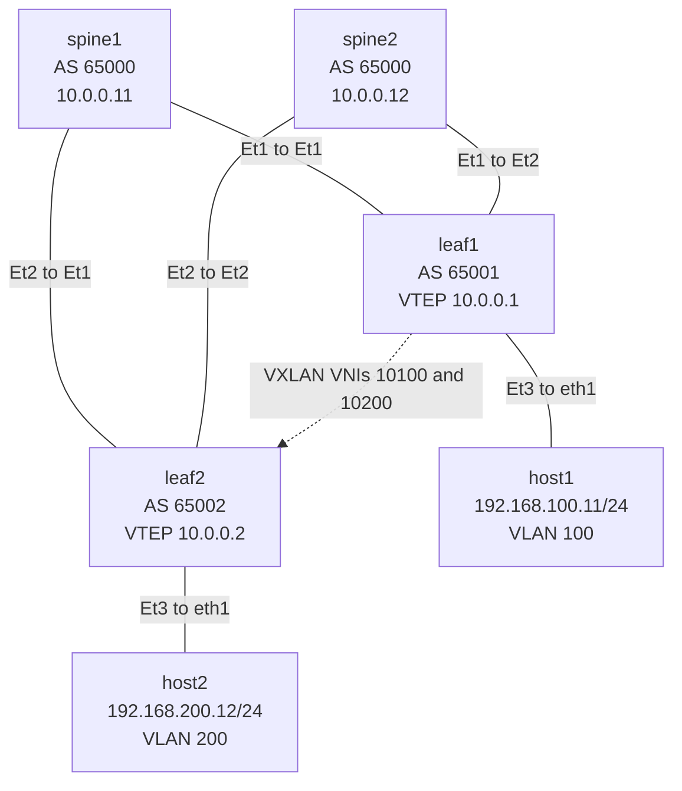
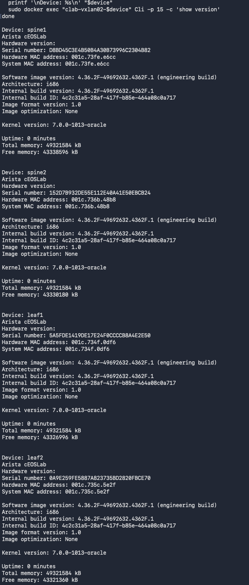
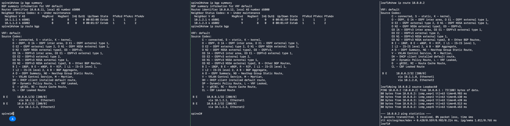
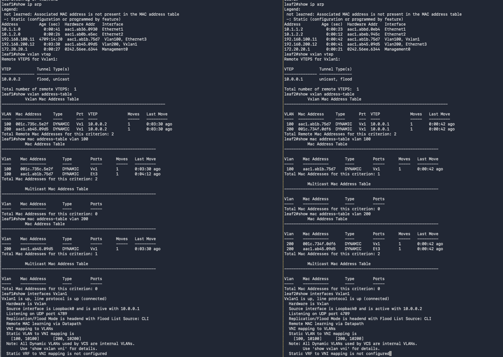
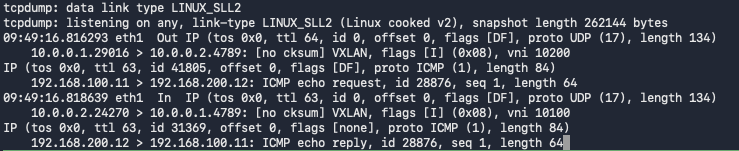

# 02 Lab 02 Layer 3 VXLAN (stretched L2)

## Before You Begin

If you have not prepared your Ubuntu lab environment, complete [00 Lab Setup](../00_Lab_Setup/README.md) first. This lab assumes Docker, Containerlab, tmux, the Linux host image, and the Arista cEOS image are already installed and available.

This lab uses **Arista cEOS 4.36.2F**, tagged **`ceos:4.36.2F`**. If you choose another release, read its release notes for compatibility requirements and known issues, then update every image reference in commands and topology files to your chosen version. Use the resource baseline in Lab 00; four switch containers may take longer to boot than the setup lab.

## Purpose

Use the same two-spine, two-leaf topology as Lab01, but place the hosts in **different VLANs and IP subnets**. Host1 connects to leaf1 in VLAN 100; host2 connects to leaf2 in VLAN 200. Add routing at the leaves so that the hosts can communicate over VXLAN.

The eBGP underlay carries VTEP loopback reachability. Static VXLAN flood lists and data-plane MAC learning provide the overlay. **EVPN is not required for this lab**, and there is no L3 VNI, overlay BGP session, or tenant route advertisement to the spines.

Both leaves have VLANs 100 and 200, both VLAN-to-VNI mappings, and an SVI in each subnet. Their SVI addresses are unique; this lab does not use an anycast gateway. Host1 uses leaf1's `192.168.100.1` gateway, while host2 uses leaf2's `192.168.200.1` gateway.

This is an ingress-routing design: the sending leaf routes into the destination subnet, then VXLAN bridges the packet to the receiving leaf. Each direction has one overlay routing operation. Lab03 will introduce BGP EVPN and symmetric IRB after this lab has been tested.

### How a packet travels

1. Host1 sends a packet for `192.168.200.12` to its gateway, `192.168.100.1`, on leaf1.
2. Leaf1 routes it from VLAN 100 to VLAN 200, resolving host2's MAC through the extended VLAN 200.
3. Leaf1 encapsulates the routed frame in **VNI 10200**, with outer source `10.0.0.1` and destination `10.0.0.2`.
4. A spine routes the outer packet to leaf2. Leaf2 decapsulates and bridges it from VLAN 200 to host2 on Ethernet3.
5. For the reply, leaf2 routes into VLAN 100 and encapsulates the frame in **VNI 10100**. Leaf1 decapsulates and bridges it to host1.

The IP source and destination remain the host addresses during encapsulation; the ingress routing operation changes the inner Ethernet header and decrements the inner IP TTL. ARP and other flooded traffic may appear in either VNI before unicast forwarding settles.

This virtual lab teaches configuration and forwarding behaviour. It does not measure physical line-rate or lossless AI networking performance. See [Arista's VXLAN routing documentation](https://www.arista.com/en/um-eos/eos-vxlan-configuration#vxlan-routing-configuration) for the routing and bridging building blocks.

## Topology



Each leaf connects to **both** spines. The dotted connection is the logical VXLAN tunnel, not a physical leaf-to-leaf cable. GitHub renders the Mermaid diagram above; the link table below also provides the complete wiring map.

| Link | First endpoint | Second endpoint |
| --- | --- | --- |
| 1 | spine1 Ethernet1 | leaf1 Ethernet1 |
| 2 | spine1 Ethernet2 | leaf2 Ethernet1 |
| 3 | spine2 Ethernet1 | leaf1 Ethernet2 |
| 4 | spine2 Ethernet2 | leaf2 Ethernet2 |
| 5 | leaf1 Ethernet3 | host1 eth1 |
| 6 | leaf2 Ethernet3 | host2 eth1 |

Containerlab `eth1`, `eth2`, and `eth3` map to EOS `Ethernet1`, `Ethernet2`, and `Ethernet3`. Container `eth0` is the management connection, separate from the lab data path.

## Addressing Plan

| Device | AS | Loopback0 | Ethernet1 | Ethernet2 | Ethernet3 |
| --- | --- | --- | --- | --- | --- |
| spine1 | 65000 | 10.0.0.11/32 | 10.1.1.0/31 | 10.1.1.2/31 | Unused |
| spine2 | 65000 | 10.0.0.12/32 | 10.1.2.0/31 | 10.1.2.2/31 | Unused |
| leaf1 | 65001 | 10.0.0.1/32 | 10.1.1.1/31 | 10.1.2.1/31 | VLAN 100 access |
| leaf2 | 65002 | 10.0.0.2/32 | 10.1.1.3/31 | 10.1.2.3/31 | VLAN 200 access |

| Host | VLAN | Data interface | Address | Lab gateway | Route through gateway |
| --- | --- | --- | --- | --- | --- |
| host1 | 100 | eth1 | 192.168.100.11/24 | 192.168.100.1 on leaf1 | 192.168.200.0/24 |
| host2 | 200 | eth1 | 192.168.200.12/24 | 192.168.200.1 on leaf2 | 192.168.100.0/24 |

| VLAN | Subnet | VNI | leaf1 SVI | leaf2 SVI |
| --- | --- | --- | --- | --- |
| 100 | 192.168.100.0/24 | 10100 | 192.168.100.1/24 | 192.168.100.2/24 |
| 200 | 192.168.200.0/24 | 10200 | 192.168.200.2/24 | 192.168.200.1/24 |

The `.2` SVI addresses provide routing interfaces for the remote host VLANs on each leaf; they are not the hosts' selected gateways. Both subnets must exist as connected routes on both leaves for this design. No subnet is advertised into the BGP underlay.

The hosts use explicit routes to the other lab subnet through their local leaf. Their existing management default routes through `eth0` remain available, while lab traffic follows the more specific `/24` route through `eth1`.

## 1 Verify the Environment

Run all `bash` blocks in Ubuntu unless otherwise stated. EOS command blocks run inside the named switch CLI. Start with this lab's fresh containers; do not reuse Lab01's switch configuration without applying the changes below.

### Verification

```bash
uname -m
free -h
df -h /
sudo systemctl is-active docker
containerlab version
tmux -V
sudo docker images ceos:4.36.2F
sudo docker images ghcr.io/hellt/network-multitool:latest
```

Expect `x86_64`, an active Docker service, tool versions, and matching image rows. If anything is missing, return to Lab 00. The pre-deployment checks in step 4 confirm that no earlier lab is still deployed.

Install the Ubuntu packet capture utility for the verification exercise:

```bash
sudo apt update
sudo apt install -y tcpdump
```

### Verification

```bash
tcpdump --version
command -v nsenter
```

Expect a tcpdump version and a path to `nsenter`, supplied by Ubuntu's `util-linux` package.

## 2 Create the Lab Directory

From your cloned repository root:

```bash
mkdir -p 02_Lab02_L3_VXLAN
cd 02_Lab02_L3_VXLAN
mkdir -p "config_backup"
```

Use `config_backup` as the configuration backup directory for this and all following labs. Run subsequent Ubuntu commands from this lab directory.

### Verification

```bash
pwd
ls -ld "config_backup"
```

The working path should end in `02_Lab02_L3_VXLAN`, and the backup directory should exist.

## 3 Create the Topology File

Paste this complete block to create `Lab02_L3_VXLAN_Topology.yml`. It defines six devices and six links. Hosts use a 1500-byte data MTU; the switch underlay will use a larger IP MTU to accommodate VXLAN overhead.

```bash
cat > Lab02_L3_VXLAN_Topology.yml <<'EOF'
name: vxlan02

topology:
  kinds:
    arista_ceos:
      image: ceos:4.36.2F

  nodes:
    spine1:
      kind: arista_ceos
    spine2:
      kind: arista_ceos
    leaf1:
      kind: arista_ceos
    leaf2:
      kind: arista_ceos

    host1:
      kind: linux
      image: ghcr.io/hellt/network-multitool:latest
      exec:
        - ip link set eth1 mtu 1500
        - ip link set eth1 up
        - ip addr replace 192.168.100.11/24 dev eth1
        - ip route replace 192.168.200.0/24 via 192.168.100.1 dev eth1

    host2:
      kind: linux
      image: ghcr.io/hellt/network-multitool:latest
      exec:
        - ip link set eth1 mtu 1500
        - ip link set eth1 up
        - ip addr replace 192.168.200.12/24 dev eth1
        - ip route replace 192.168.100.0/24 via 192.168.200.1 dev eth1

  links:
    - endpoints: ["spine1:eth1", "leaf1:eth1"]
    - endpoints: ["spine1:eth2", "leaf2:eth1"]
    - endpoints: ["spine2:eth1", "leaf1:eth2"]
    - endpoints: ["spine2:eth2", "leaf2:eth2"]
    - endpoints: ["leaf1:eth3", "host1:eth1"]
    - endpoints: ["leaf2:eth3", "host2:eth1"]
EOF
```

### Verification

```bash
ls -lh Lab02_L3_VXLAN_Topology.yml
cat Lab02_L3_VXLAN_Topology.yml
```

Check the image tag, six node entries, six links, host addresses, and the two remote-subnet routes against the tables above. The gateway IPs become reachable after step 11 configures the leaves. The next step parses and deploys the YAML; correct any errors it reports before configuring devices.

## 4 Deploy the Topology

### Check for existing labs

Before deploying, list all existing Containerlab labs:

```bash
sudo containerlab inspect --all
```

Review the lab names and topology paths. If any labs are listed, save any configurations you need, then stop and clean up each previous lab using its topology file. For example, if `dc1` is listed, replace the example path below with the path shown by inspection:

```bash
sudo containerlab destroy -t /path/to/dc1.clab.yml --cleanup
```

If Lab01 is still deployed, stop it from this directory using:

```bash
sudo containerlab destroy -t ../01_Lab01_VXLAN/Lab01_VXLAN_Topology.yml --cleanup
```

Run only the cleanup commands for labs that are present. `--cleanup` removes that lab's generated runtime directory, including configurations stored there; keep required backups outside it. Use the matching topology path rather than relying on `destroy --name dc1` alone, which can still require topology-file resolution. See the [Containerlab destroy reference](https://containerlab.dev/cmd/destroy/).

### Alternative Stop all labs and start fresh

You can also use `destroy --all` to stop and remove all deployed Containerlab labs in one command. Add `--cleanup` to remove their generated runtime directories as well:

```bash
sudo containerlab destroy --all --cleanup
```

Review and confirm the prompt. This affects every Containerlab lab on the Ubuntu host, so save any configurations you need outside the generated lab directories first. Downloaded Docker images and separately saved `config_backup` folders remain available.

### Verification before deployment

```bash
sudo containerlab inspect --all
```

Continue when inspection reports no deployed labs. Repeat the matching cleanup operation if a previous lab is still listed.

### Deploy this lab

```bash
sudo containerlab deploy -t Lab02_L3_VXLAN_Topology.yml
```

### Verification

```bash
sudo containerlab inspect -t Lab02_L3_VXLAN_Topology.yml
sudo docker ps --filter name=clab-vxlan02- --format 'table {{.Names}}\t{{.Image}}\t{{.Status}}'
```

Expect four cEOS containers and two Linux containers:

```text
clab-vxlan02-spine1
clab-vxlan02-spine2
clab-vxlan02-leaf1
clab-vxlan02-leaf2
clab-vxlan02-host1
clab-vxlan02-host2
```

Wait for EOS to boot. Container state `running` alone does not confirm CLI readiness. Verify all four versions:

```bash
for device in spine1 spine2 leaf1 leaf2; do
  printf '\nDevice: %s\n' "$device"
  sudo docker exec "clab-vxlan02-$device" Cli -p 15 -c 'show version'
done
```

Each switch should report **4.36.2F**. If a CLI is unavailable, allow more time and check `sudo docker logs clab-vxlan02-spine1`, substituting the affected device name.

### Sample show version output

The screenshot below shows the version checks for spine1, spine2, leaf1, and leaf2. Each reports a software image version beginning with `4.36.2F`. Build identifiers, serial numbers, MAC addresses, kernel versions, uptime, and memory values may differ in your environment.



## 5 Open the Devices in tmux

This script creates **seven terminal panes in one tmux window**: four switch CLIs, two host shells, and one Ubuntu shell. Each device pane starts its `docker exec` command automatically. The Ubuntu pane is used for lab control commands and packet captures. The script enables mouse support automatically, so you can click a pane to select it and drag its borders to resize it.

Run this from `02_Lab02_L3_VXLAN`, outside an existing tmux session, after all six containers are ready. Use a large terminal window. Create the script below, or use the supplied `Lab02_Open_Terminals.sh` file:

```bash
cat > Lab02_Open_Terminals.sh <<'EOF'
#!/bin/bash
set -e

if [[ -n "${TMUX:-}" ]]; then
  printf 'Run this script from an Ubuntu terminal outside tmux.\n'
  exit 1
fi

session="vxlan02"
lab_dir=$(cd -- "$(dirname -- "${BASH_SOURCE[0]}")" && pwd)

if tmux has-session -t "$session" 2>/dev/null; then
  tmux set -g mouse on
  tmux attach-session -t "$session"
  exit 0
fi

sudo -v

tmux new-session -d -s "$session" -n devices -c "$lab_dir" \
  'sudo docker exec -it clab-vxlan02-spine1 Cli'

for device in spine2 leaf1 leaf2; do
  tmux split-window -t "$session:devices" -c "$lab_dir" \
    "sudo docker exec -it clab-vxlan02-$device Cli"
  tmux select-layout -t "$session:devices" tiled
done

for device in host1 host2; do
  tmux split-window -t "$session:devices" -c "$lab_dir" \
    "sudo docker exec -it clab-vxlan02-$device sh"
  tmux select-layout -t "$session:devices" tiled
done

# The seventh pane is the Ubuntu shell for lab commands and captures.
tmux split-window -t "$session:devices" -c "$lab_dir" 'bash'
tmux select-layout -t "$session:devices" tiled
tmux set -g mouse on
tmux attach-session -t "$session"
EOF

bash Lab02_Open_Terminals.sh
```

If a device pane asks for your Ubuntu sudo password, enter it there to complete the connection. On switches, enter `enable` when you need privileged commands. If your account already has Docker access, you may remove `sudo` from the script's `docker exec` commands.

The script reattaches if session `vxlan02` already exists. If an existing `vxlan02` session has an incomplete layout, detach and run `tmux kill-session -t vxlan02` from an Ubuntu terminal before launching this script again. This closes the old terminals and leaves the lab containers running.

| Keys | Action |
| --- | --- |
| Click inside a pane | Select that pane |
| Drag a pane border | Resize the panes |
| `Ctrl+b`, then an arrow key | Move between panes using the keyboard |
| `Ctrl+b`, then `q`, then a number | Select the numbered pane |
| `Ctrl+b`, then `z` | Zoom the current pane; repeat to restore |
| `Ctrl+b`, then `d` | Detach without ending the session |

Reconnect using `tmux attach-session -t vxlan02`, or run the script again from outside tmux.

### Verification

In the Ubuntu pane:

```bash
tmux list-sessions
tmux list-panes -t vxlan02:devices
tmux list-panes -t vxlan02:devices -F '#{pane_id}' | wc -l
tmux show-options -g mouse
```

Expect session `vxlan02`, seven pane entries, a count of `7`, and `mouse on`. Confirm that four panes show switch prompts, two show Linux host shell prompts, and one shows the Ubuntu shell. In each switch pane, run:

```text
enable
show hostname
show lldp neighbors
```

Confirm the device identity before pasting a configuration. Each switch should see its two switch neighbors from the link table. Linux hosts do not necessarily advertise LLDP. See the [tmux guide](https://github.com/tmux/tmux/wiki/Getting-Started) for additional controls.

## 6 Configure the Underlay on spine1

In the **spine1 EOS pane**:

```text
enable
configure terminal
hostname spine1
ip routing
interface Loopback0
   ip address 10.0.0.11/32
interface Ethernet1
   description TO_LEAF1_ETHERNET1
   no switchport
   mtu 9000
   ip address 10.1.1.0/31
   no shutdown
interface Ethernet2
   description TO_LEAF2_ETHERNET1
   no switchport
   mtu 9000
   ip address 10.1.1.2/31
   no shutdown
router bgp 65000
   router-id 10.0.0.11
   maximum-paths 2
   neighbor 10.1.1.1 remote-as 65001
   neighbor 10.1.1.3 remote-as 65002
   network 10.0.0.11/32
end
```

### Verification

```text
show ip interface brief
show interfaces Ethernet1
show running-config interfaces Ethernet1
show running-config section router bgp
```

Check both routed interface addresses, Loopback0, and the two configured BGP neighbors. BGP will establish after the leaves are configured. The routed IP MTU should be 9000. See [Arista's MTU reference](https://www.arista.com/en/um-eos/eos-data-transfer) for the interface `mtu` command.

## 7 Configure the Underlay on spine2

In the **spine2 EOS pane**:

```text
enable
configure terminal
hostname spine2
ip routing
interface Loopback0
   ip address 10.0.0.12/32
interface Ethernet1
   description TO_LEAF1_ETHERNET2
   no switchport
   mtu 9000
   ip address 10.1.2.0/31
   no shutdown
interface Ethernet2
   description TO_LEAF2_ETHERNET2
   no switchport
   mtu 9000
   ip address 10.1.2.2/31
   no shutdown
router bgp 65000
   router-id 10.0.0.12
   maximum-paths 2
   neighbor 10.1.2.1 remote-as 65001
   neighbor 10.1.2.3 remote-as 65002
   network 10.0.0.12/32
end
```

### Verification

```text
show ip interface brief
show interfaces Ethernet2
show running-config interfaces Ethernet2
show running-config section router bgp
```

Confirm the spine2 addresses and neighbors against the addressing plan. Neither spine needs VLAN 100, VLAN 200, an SVI, or a Vxlan1 interface.

## 8 Configure the Underlay on leaf1

In the **leaf1 EOS pane**:

```text
enable
configure terminal
hostname leaf1
ip routing
interface Loopback0
   ip address 10.0.0.1/32
interface Ethernet1
   description TO_SPINE1_ETHERNET1
   no switchport
   mtu 9000
   ip address 10.1.1.1/31
   no shutdown
interface Ethernet2
   description TO_SPINE2_ETHERNET1
   no switchport
   mtu 9000
   ip address 10.1.2.1/31
   no shutdown
router bgp 65001
   router-id 10.0.0.1
   maximum-paths 2
   neighbor 10.1.1.0 remote-as 65000
   neighbor 10.1.2.0 remote-as 65000
   network 10.0.0.1/32
end
```

### Verification

```text
show ip interface brief
ping 10.1.1.0
ping 10.1.2.0
show ip bgp summary
```

Both directly connected spine addresses should reply. The two BGP sessions should establish after convergence. In the summary, a numeric received-prefix count in the final column indicates an established session; `Idle`, `Active`, or `Connect` indicates a problem or an incomplete startup.

## 9 Configure the Underlay on leaf2

In the **leaf2 EOS pane**:

```text
enable
configure terminal
hostname leaf2
ip routing
interface Loopback0
   ip address 10.0.0.2/32
interface Ethernet1
   description TO_SPINE1_ETHERNET2
   no switchport
   mtu 9000
   ip address 10.1.1.3/31
   no shutdown
interface Ethernet2
   description TO_SPINE2_ETHERNET2
   no switchport
   mtu 9000
   ip address 10.1.2.3/31
   no shutdown
router bgp 65002
   router-id 10.0.0.2
   maximum-paths 2
   neighbor 10.1.1.2 remote-as 65000
   neighbor 10.1.2.2 remote-as 65000
   network 10.0.0.2/32
end
```

### Verification

```text
show ip interface brief
ping 10.1.1.2
ping 10.1.2.2
show ip bgp summary
```

Both spine addresses should reply, and leaf2 should have two established BGP sessions.

## 10 Verify the Complete Underlay

The VTEP loopbacks must be reachable before adding VXLAN. Each leaf advertises its own loopback to both spines; each spine advertises it onward to the other leaf.

### Verification

On **each of the four switches**:

```text
show ip bgp summary
show ip route bgp
```

Each switch should have two established neighbors. On **leaf1**:

```text
show ip route 10.0.0.2
ping 10.0.0.2 source Loopback0
```

Expect two next hops for the remote VTEP: `10.1.1.0` and `10.1.2.0`. On **leaf2**:

```text
show ip route 10.0.0.1
ping 10.0.0.1 source Loopback0
```

Expect next hops `10.1.1.2` and `10.1.2.2`. Both loopback-sourced ping tests must succeed. If only one next hop appears, check both uplinks, BGP sessions, and `maximum-paths 2` before proceeding.


### Sample underlay verification output

The screenshot below shows established BGP sessions and learned VTEP routes on both spines. On leaf1, the remote VTEP `10.0.0.2/32` has two next hops, and the loopback-sourced ping succeeds with 0% packet loss. Complete the corresponding checks on leaf2 before proceeding.



## 11 Configure Routed Gateways and VXLAN

Create both VLANs and both SVIs on each leaf, even though each leaf has only one attached host. The ingress leaf needs the destination subnet's SVI and VNI to route before encapsulating. Use unique SVI IPs from the table above, rather than configuring the same ordinary SVI address on both devices.

The `no autostate` command keeps each SVI operational when its VLAN has no local physical host port. This is useful here because leaf1 has no local host in VLAN 200, and leaf2 has none in VLAN 100. It does not prove VXLAN forwarding is working; the host tests below do that. See [Arista's SVI autostate documentation](https://www.arista.com/en/um-eos/eos-virtual-lans-vlans).

### Configure leaf1

In the **leaf1 EOS pane**:

```text
enable
configure terminal
vlan 100
   name HOST1_SUBNET
vlan 200
   name HOST2_SUBNET
interface Ethernet3
   description TO_HOST1_VLAN100
   switchport
   switchport mode access
   switchport access vlan 100
   spanning-tree portfast
   no shutdown
interface Vlan100
   description HOST1_LOCAL_GATEWAY
   ip address 192.168.100.1/24
   no autostate
   no shutdown
interface Vlan200
   description REMOTE_HOST2_SUBNET
   ip address 192.168.200.2/24
   no autostate
   no shutdown
interface Vxlan1
   vxlan source-interface Loopback0
   vxlan udp-port 4789
   vxlan vlan 100 vni 10100
   vxlan vlan 200 vni 10200
   vxlan flood vtep 10.0.0.2
end
```

### Verification on leaf1

```text
show vlan
show interfaces Ethernet3 switchport
show ip interface brief
show ip route 192.168.100.0/24
show ip route 192.168.200.0/24
show vxlan vni
show interfaces Vxlan1
```

Expect Ethernet3 in VLAN 100, both SVIs up with their planned addresses, both host subnets as connected routes, and mappings `100 -> 10100` and `200 -> 10200`. The VTEP source is `10.0.0.1`, with remote flood destination `10.0.0.2`. Check `show running-config interfaces Vxlan1` if needed.

### Configure leaf2

In the **leaf2 EOS pane**:

```text
enable
configure terminal
vlan 100
   name HOST1_SUBNET
vlan 200
   name HOST2_SUBNET
interface Ethernet3
   description TO_HOST2_VLAN200
   switchport
   switchport mode access
   switchport access vlan 200
   spanning-tree portfast
   no shutdown
interface Vlan100
   description REMOTE_HOST1_SUBNET
   ip address 192.168.100.2/24
   no autostate
   no shutdown
interface Vlan200
   description HOST2_LOCAL_GATEWAY
   ip address 192.168.200.1/24
   no autostate
   no shutdown
interface Vxlan1
   vxlan source-interface Loopback0
   vxlan udp-port 4789
   vxlan vlan 100 vni 10100
   vxlan vlan 200 vni 10200
   vxlan flood vtep 10.0.0.1
end
```

### Verification on leaf2

```text
show vlan
show interfaces Ethernet3 switchport
show ip interface brief
show ip route 192.168.100.0/24
show ip route 192.168.200.0/24
show vxlan vni
show interfaces Vxlan1
```

Expect Ethernet3 in VLAN 200, both SVIs up, both host subnets as connected routes, and the same two VNI mappings. Leaf2 uses VTEP `10.0.0.2` and floods to `10.0.0.1`.

Do not add the host subnets to BGP, use `redistribute connected`, or configure Vxlan1 on the spines. Those changes could create a different forwarding design from the one being tested.

## 12 Verify Gateways and Cross Subnet Communication

### Check host1

In the **host1 pane**:

```bash
ip addr show eth1
ip route
ip route get 192.168.200.12
ping -c 4 192.168.100.1
```

### Verification on host1

Expect `192.168.100.11/24` on `eth1`. The route lookup should use `via 192.168.100.1 dev eth1` with source `192.168.100.11`, and the local gateway should reply. A route through `eth0` indicates a missing or incorrect lab route.

### Check host2

In the **host2 pane**:

```bash
ip addr show eth1
ip route
ip route get 192.168.100.11
ping -c 4 192.168.200.1
```

### Verification on host2

Expect `192.168.200.12/24` on `eth1`. The route lookup should use `via 192.168.200.1 dev eth1` with source `192.168.200.12`. The local gateway should reply.

### Test the remote hosts

From **host1**:

```bash
ping -c 5 192.168.200.12
ping -c 4 -M do -s 1472 192.168.200.12
ip neigh show dev eth1
```

From **host2**:

```bash
ping -c 5 192.168.100.11
ping -c 4 -M do -s 1472 192.168.100.11
ip neigh show dev eth1
```

### Verification of host traffic

Both directions should receive replies, including the 1500-byte IPv4 packet tests. An initial packet may be lost while address resolution completes; repeat the test after convergence. Each host should resolve its gateway MAC, rather than ARPing directly for the remote host, because the destination is in a different subnet. In a fresh table, host1 has a neighbor for `192.168.100.1`, and host2 has one for `192.168.200.1`.

### Verify the leaves and spines

On **both leaves**:

```text
show ip arp
show vxlan vtep
show vxlan address-table
show mac address-table vlan 100
show mac address-table vlan 200
show interfaces Vxlan1
```

The following example shows both leaves' ARP entries, remote VTEPs, local and remote MAC learning, and VLAN-to-VNI mappings after generating host traffic.



On leaf1, expect host1's MAC on Ethernet3 in VLAN 100 and host2's MAC through Vxlan1 in VLAN 200. On leaf2, expect host2's MAC on Ethernet3 in VLAN 200 and host1's MAC through Vxlan1 in VLAN 100. ARP should resolve both host IPs on each leaf after bidirectional traffic. Gateway SVI MACs may also appear in the overlay tables.

On **each spine**:

```text
show ip route 10.0.0.1
show ip route 10.0.0.2
show ip route 192.168.100.0/24
show ip route 192.168.200.0/24
```

### Verification of forwarding separation

The spines should have VTEP loopback routes but no specific host-subnet routes. Host traffic must use VXLAN between the leaves; successful cross-subnet pings should not depend on advertising tenant subnets into the underlay.

## 13 Capture Routed Traffic over VXLAN

In the **Ubuntu pane**, capture at leaf1:

```bash
leaf1_pid=$(sudo docker inspect --format '{{.State.Pid}}' clab-vxlan02-leaf1)
sudo nsenter -t "$leaf1_pid" -n tcpdump -ni any -c 12 -vv 'udp port 4789'
```

While the capture waits, generate traffic in the **host1 pane**:

```bash
ping -c 10 192.168.200.12
```

### Verification

Look for both of these unicast data flows after ARP resolves:

| Traffic | Outer source | Outer destination | VNI | Inner source and destination |
| --- | --- | --- | --- | --- |
| Echo request | 10.0.0.1 | 10.0.0.2 | 10200 | 192.168.100.11 to 192.168.200.12 |
| Echo reply | 10.0.0.2 | 10.0.0.1 | 10100 | 192.168.200.12 to 192.168.100.11 |

The different VNIs demonstrate ingress routing into the destination VLAN in each direction. This lab uses two L2 VNIs to carry routed frames, rather than a shared transit L3 VNI. The spines forward the outer packets without needing the inner host routes.

The capture stops after twelve matching packets. If the first capture contains only ARP, rerun it after the pings have populated neighbor tables. Use `Ctrl+c` if it remains waiting. Capturing on `any` covers either ECMP uplink and may show duplicate observations; this does not imply duplicate host delivery.

### Sample routed VXLAN capture output

The capture below shows the ICMP echo request from `192.168.100.11` to `192.168.200.12` carried in VNI **10200**, and the echo reply carried in VNI **10100**. The outer packets travel between VTEPs `10.0.0.1` and `10.0.0.2` using UDP destination port 4789, matching the expected forwarding paths above.



## 14 Save and Back Up All Switch Configurations

In the **Ubuntu pane**, save each switch's running configuration to its startup configuration:

```bash
for device in spine1 spine2 leaf1 leaf2; do
  sudo docker exec "clab-vxlan02-$device" Cli -p 15 -c 'write memory' || break
done
```

Check each command's output for errors. `-p 15` selects privileged EOS mode, as required for saving and exporting configuration. See [Containerlab's save reference](https://containerlab.dev/cmd/save/).

Export backups into the **`config_backup`** folder. Temporary files prevent a failed export from immediately replacing an earlier backup:

```bash
mkdir -p "config_backup"
for device in spine1 spine2 leaf1 leaf2; do
  backup="config_backup/$device.cfg"
  if sudo docker exec "clab-vxlan02-$device" Cli -p 15 -c 'show running-config' > "$backup.tmp"; then
    if grep -q '^hostname ' "$backup.tmp"; then
      mv -- "$backup.tmp" "$backup"
    else
      printf 'No hostname found in export for %s; inspect %s.tmp\n' "$device" "$backup"
      break
    fi
  else
    printf 'Export failed for %s; inspect %s.tmp\n' "$device" "$backup"
    break
  fi
done
```

### Verification

```bash
ls -lh "config_backup/"
for device in spine1 spine2 leaf1 leaf2; do
  printf '\nBackup: %s\n' "$device"
  head -n 15 "config_backup/$device.cfg"
  grep -nE '^hostname |^interface |ip address 192\.168\.|^router bgp |vxlan ' "config_backup/$device.cfg"
done
```

Expect **four nonempty `.cfg` files** with the correct hostnames. The leaves should include both VLAN SVIs, both VNI mappings, Vxlan1, and the remote flood destination. The spines should have routed uplinks and BGP without tenant SVIs or VXLAN configuration. Review the full files for errors and credentials before committing them to GitHub. A hostname check alone is not full configuration validation.

The topology preserves host addresses, data MTUs, and remote-subnet routes, so no separate host configuration backup is needed for this lab. Keep the README, `Lab02_L3_VXLAN_Topology.yml`, `Lab02_Open_Terminals.sh`, and the four backups together. Backups must remain outside the generated `clab-vxlan02/` directory.

## 15 Terminate the Lab and Clean Up Ubuntu

Complete and verify the backups first. From the **Ubuntu pane**, run:

```bash
sudo containerlab destroy -t Lab02_L3_VXLAN_Topology.yml --cleanup
```

This removes this lab's containers, virtual links, and generated runtime directory. It retains your topology and `config_backup` folder. See the [Containerlab cleanup reference](https://containerlab.dev/cmd/destroy/#cleanup).

### Verification

```bash
sudo docker ps -a --filter name=clab-vxlan02- --format 'table {{.Names}}\t{{.Status}}'
test ! -d clab-vxlan02 && printf 'Generated lab directory removed\n'
ls -lh Lab02_L3_VXLAN_Topology.yml "config_backup/"
```

The container listing should have no device rows, the directory check should confirm removal, and your topology and four backups should remain. Docker images stay installed for later labs.

Detach with `Ctrl+b`, then `d`. In the Ubuntu terminal **outside tmux**, close this lab's session and clear the terminal display:

```bash
tmux kill-session -t vxlan02
clear
```

### Verification

```bash
if tmux has-session -t vxlan02 2>/dev/null; then
  printf 'The lab tmux session is still running\n'
else
  printf 'The lab tmux session is closed\n'
fi
free -h
sudo docker images ceos:4.36.2F
```

Expect the session to be closed and the cEOS image still present. Ubuntu is ready for the next lab. `clear` clears the display; lab resources were removed by the destroy command.

## Troubleshooting

| Symptom | Verification and correction |
| --- | --- |
| BGP or VTEP loopback test fails | Check the step 10 underlay tests before troubleshooting VXLAN. The host routes cannot compensate for missing VTEP reachability. |
| Host cannot ping its local gateway | Verify the host IP, leaf Ethernet3 access VLAN, SVI address, `ip routing`, and SVI state. |
| Host sends traffic through eth0 | Use `ip route get` to verify the explicit remote-subnet route from the topology's `exec` commands. |
| Remote-subnet route missing from a leaf | Both VLAN SVIs must exist and be operational. Check `no autostate` for VLANs without a local physical host port. |
| Local gateway works but remote host fails | Check both VLANs and VNI mappings on both leaves, flood lists, host routes, and remote MAC/ARP learning. |
| Only one VNI appears | Generate pings in both directions and capture after ARP settles. Requests and replies use the destination VLAN's VNI. |
| Small ping works but full-size test fails | Check host MTU 1500 and the larger routed uplink MTUs on all switches. |
| Unexpected host subnet routes on the spines | Remove unintended BGP host-subnet `network` statements or connected-route redistribution; the supplied underlay advertises loopbacks only. |
| Config export contains an error | Use `Cli -p 15`, inspect temporary exports, and replace failed backups before cleanup. |
| Redeploy starts with empty switch configuration | A clean deployment without `startup-config` references requires configuration again. Follow Lab 00's restoration section, using this lab's `config_backup` files. |

## Completion Checklist

- All four switches ran cEOS 4.36.2F.
- All BGP sessions established and both VTEP loopbacks were reachable.
- VLAN 100 and VLAN 200 mapped to VNIs 10100 and 10200 on both leaves.
- Both leaves had unique SVI addresses and connected routes for both subnets.
- Host1 reached gateway 192.168.100.1 and host2 reached gateway 192.168.200.1.
- Both host route lookups selected the local leaf gateway through eth1.
- Cross-subnet pings and full-size IPv4 tests succeeded in both directions.
- Packet capture showed requests in VNI 10200 and replies in VNI 10100.
- The spines carried VTEP routes without learning tenant subnet routes.
- Four switch configurations were exported to `config_backup`.
- Lab containers, runtime files, and the tmux session were removed after verification.

After checking and testing this lab, continue to the planned **Lab03 BGP EVPN symmetric IRB** exercise. That lab is a separate next step and is not required to complete this one.
