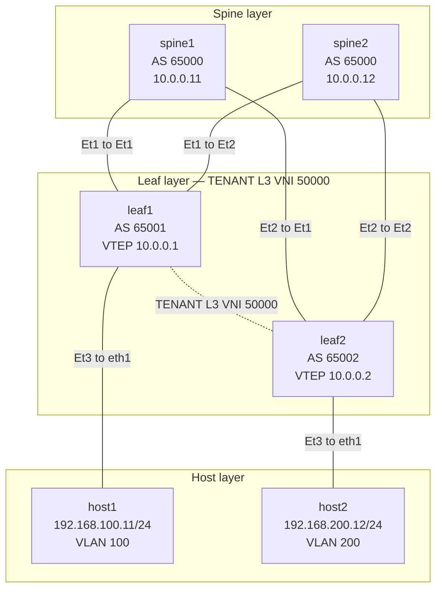
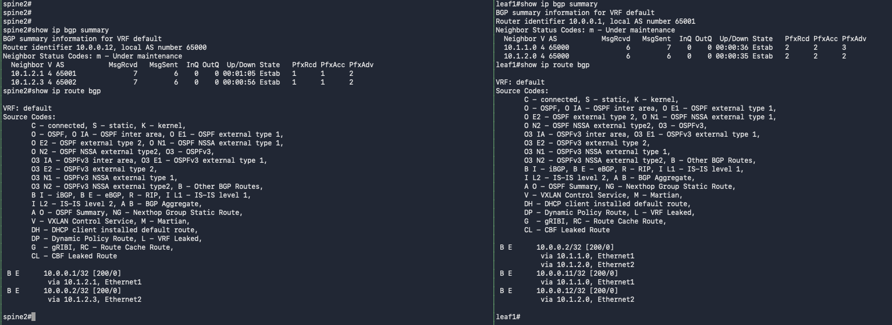
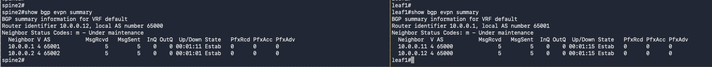

# 03 Lab 03 BGP EVPN Symmetric IRB

## Before You Begin

If you have not prepared your Ubuntu lab environment, complete [00 Lab Setup](../00_Lab_Setup/README.md) first. This lab assumes Docker, Containerlab, tmux, the Linux host image, and the Arista cEOS image are already installed and available.

This lab uses **Arista cEOS 4.36.2F**, tagged **`ceos:4.36.2F`**. If you choose another release, read its release notes for compatibility requirements and known issues, then update every image reference in commands and topology files to your chosen version. Use the resource baseline in Lab 00; four switch containers may take longer to boot than the setup lab.

## Purpose

Build a **BGP EVPN VXLAN fabric with symmetric integrated routing and bridging (IRB)**. Keep the two-spine, two-leaf physical topology and host addresses from Lab02, but replace static overlay learning with EVPN and move tenant routing into a dedicated VRF.

Host1 connects to leaf1 in VLAN 100 (`192.168.100.0/24`), and host2 connects to leaf2 in VLAN 200 (`192.168.200.0/24`). Leaf1 needs only VLAN 100 and its SVI; leaf2 needs only VLAN 200 and its SVI. Both leaves join **VRF TENANT**, mapped to **L3 VNI 50000**.

An eBGP IPv4 underlay provides loopback reachability. Separate loopback-to-loopback eBGP sessions exchange EVPN routes through both spines. The spines act as **eBGP EVPN transit speakers**, rather than iBGP route reflectors or VXLAN endpoints. There is no spine-to-spine overlay session, direct leaf-to-leaf cable, or manually configured VXLAN flood list.

The lab uses **Type-5 IP-prefix routes** for tenant subnet reachability and **Type-2 MAC/IP routes** for learned host information. Type-5 routes allow remote subnet routing before every host is learned. After host traffic generates ARP/MAC state, Type-2 host routes may provide a more specific forwarding entry.

### What changes from Lab02

| Item | Lab02 | Lab03 |
| --- | --- | --- |
| Overlay control plane | Static flood lists and data-plane learning | BGP EVPN |
| Tenant routing table | Default VRF | VRF TENANT |
| Host VLANs on each leaf | Both VLANs 100 and 200 | Only the locally attached host VLAN |
| Host gateways | Ordinary, unique SVIs | Virtual gateway IPs with a common virtual gateway MAC |
| Cross-subnet tunnel VNI | Destination subnet VNI: 10200 or 10100 | Shared L3 VNI 50000 in both directions |
| Overlay routing operations | Ingress leaf only | Ingress leaf and egress leaf |

### How a packet travels

1. Host1 sends a packet for `192.168.200.12` to gateway `192.168.100.1` on leaf1.
2. Leaf1 routes from VLAN 100 into TENANT's L3 VNI 50000 using an EVPN-learned route. The tunnel's inner destination MAC identifies the remote router, rather than host2.
3. A spine routes the outer packet between VTEPs `10.0.0.1` and `10.0.0.2`.
4. Leaf2 decapsulates into VRF TENANT, then routes the packet out VLAN 200 to host2.
5. The reply follows the reverse process using the **same L3 VNI 50000**.

The underlay remains in the default VRF. Tenant subnets are exchanged in EVPN and imported into TENANT; they are not advertised into the spines' default IPv4 routing tables. See [Arista's IRB overview](https://www.arista.com/en/um-eos/eos-integrated-routing-and-bridging) for the symmetric forwarding model.

This virtual lab teaches configuration, route exchange, and forwarding behaviour. It does not validate physical bandwidth or lossless AI networking performance.

## Topology



Each leaf connects to **both** spines. The dotted line represents the shared TENANT L3 VNI 50000 logical overlay between the leaves; there is no physical leaf-to-leaf cable. GitHub renders the Mermaid diagram above; the link table below also provides the complete wiring map.

| Link | First endpoint | Second endpoint |
| --- | --- | --- |
| 1 | spine1 Ethernet1 | leaf1 Ethernet1 |
| 2 | spine1 Ethernet2 | leaf2 Ethernet1 |
| 3 | spine2 Ethernet1 | leaf1 Ethernet2 |
| 4 | spine2 Ethernet2 | leaf2 Ethernet2 |
| 5 | leaf1 Ethernet3 | host1 eth1 |
| 6 | leaf2 Ethernet3 | host2 eth1 |

Containerlab `eth1`, `eth2`, and `eth3` map to EOS `Ethernet1`, `Ethernet2`, and `Ethernet3`. Container `eth0` is the management connection, separate from the lab data path.

## Addressing Plan

| Device | AS | Loopback0 | Ethernet1 | Ethernet2 | Ethernet3 |
| --- | --- | --- | --- | --- | --- |
| spine1 | 65000 | 10.0.0.11/32 | 10.1.1.0/31 | 10.1.1.2/31 | Unused |
| spine2 | 65000 | 10.0.0.12/32 | 10.1.2.0/31 | 10.1.2.2/31 | Unused |
| leaf1 | 65001 | 10.0.0.1/32 | 10.1.1.1/31 | 10.1.2.1/31 | VLAN 100 access |
| leaf2 | 65002 | 10.0.0.2/32 | 10.1.1.3/31 | 10.1.2.3/31 | VLAN 200 access |

| Host | VLAN | Data interface | Address | Lab gateway | Route through gateway |
| --- | --- | --- | --- | --- | --- |
| host1 | 100 | eth1 | 192.168.100.11/24 | 192.168.100.1 on leaf1 | 192.168.200.0/24 |
| host2 | 200 | eth1 | 192.168.200.12/24 | 192.168.200.1 on leaf2 | 192.168.100.0/24 |

| Leaf | Local VLAN and L2 VNI | Local SVI gateway | Tenant VRF | Shared L3 VNI |
| --- | --- | --- | --- | --- |
| leaf1 | VLAN 100 / VNI 10100 | 192.168.100.1/24 | TENANT | 50000 |
| leaf2 | VLAN 200 / VNI 10200 | 192.168.200.1/24 | TENANT | 50000 |

Do not configure VLAN 200 or Vlan200 on leaf1, or VLAN 100 or Vlan100 on leaf2. The L3 VNI and EVPN tenant routes provide access to the remote subnet.

| EVPN object | leaf1 RD | leaf2 RD | Route target |
| --- | --- | --- | --- |
| Local MAC VRF | 10.0.0.1:10100 | 10.0.0.2:10200 | 65000:10100 for VLAN 100; 65000:10200 for VLAN 200 |
| TENANT IP VRF | 10.0.0.1:50000 | 10.0.0.2:50000 | Import and export 65000:50000 on both leaves |

The RD makes each advertised route unique. The RT controls which routes a VRF imports; the shared TENANT RT must match on both leaves. A VNI, RD, and RT have different jobs, even where their numerical values are similar. See [Arista's EVPN route-target reference](https://www.arista.com/en/um-eos/eos-evpn-and-vcs-commands).

Both leaves use gateway MAC **00:1c:73:00:00:99** with `ip address virtual`. Each subnet has one attached host and one gateway in this topology; using virtual gateway syntax prepares the design for a future subnet stretched across multiple leaves. It does not create redundant gateway instances here. The EVPN router MAC used for the L3 tunnel is a separate forwarding attribute learned from EVPN.

As in Lab02, hosts use explicit routes to the other lab subnet through their local leaf. Their management default routes remain on `eth0`; lab traffic follows the more specific `/24` route through `eth1`.

| Overlay session | First endpoint and AS | Second endpoint and AS |
| --- | --- | --- |
| 1 | leaf1 10.0.0.1 / AS 65001 | spine1 10.0.0.11 / AS 65000 |
| 2 | leaf1 10.0.0.1 / AS 65001 | spine2 10.0.0.12 / AS 65000 |
| 3 | leaf2 10.0.0.2 / AS 65002 | spine1 10.0.0.11 / AS 65000 |
| 4 | leaf2 10.0.0.2 / AS 65002 | spine2 10.0.0.12 / AS 65000 |

## 1 Verify the Environment

Run all `bash` blocks in Ubuntu unless otherwise stated. EOS command blocks run inside the named switch CLI. Start with fresh Lab03 containers. Lab02's default-VRF SVIs and static flood lists are not the starting configuration for this exercise.

### Verification

```bash
uname -m
free -h
df -h /
sudo systemctl is-active docker
containerlab version
tmux -V
sudo docker images ceos:4.36.2F
sudo docker images ghcr.io/hellt/network-multitool:latest
```

Expect `x86_64`, an active Docker service, tool versions, and matching image rows. If anything is missing, return to Lab 00. The pre-deployment checks in step 4 confirm that no earlier lab is still deployed.

Install the Ubuntu packet capture utility for the verification exercise:

```bash
sudo apt update
sudo apt install -y tcpdump
```

### Verification

```bash
tcpdump --version
command -v nsenter
```

Expect a tcpdump version and a path to `nsenter`, supplied by Ubuntu's `util-linux` package.

## 2 Create the Lab Directory

From your cloned repository root:

```bash
mkdir -p 03_Lab03_BGP_EVPN_SymmenticIRB
cd 03_Lab03_BGP_EVPN_SymmenticIRB
mkdir -p "config_backup"
```

Use `config_backup` as the configuration backup directory for this and all following labs. Run subsequent Ubuntu commands from this lab directory.

### Verification

```bash
pwd
ls -ld "config_backup"
```

The working path should end in `03_Lab03_BGP_EVPN_SymmenticIRB`, and the backup directory should exist.

## 3 Create the Topology File

Paste this complete block to create `Lab03_BGP_EVPN_SymmetricIRB_Topology.yml`. It defines six devices and six links. Hosts use a 1500-byte data MTU; the switch underlay will use a larger IP MTU to accommodate VXLAN overhead.

```bash
cat > Lab03_BGP_EVPN_SymmetricIRB_Topology.yml <<'EOF'
name: vxlan03

topology:
  kinds:
    arista_ceos:
      image: ceos:4.36.2F

  nodes:
    spine1:
      kind: arista_ceos
    spine2:
      kind: arista_ceos
    leaf1:
      kind: arista_ceos
    leaf2:
      kind: arista_ceos

    host1:
      kind: linux
      image: ghcr.io/hellt/network-multitool:latest
      exec:
        - ip link set eth1 mtu 1500
        - ip link set eth1 up
        - ip addr replace 192.168.100.11/24 dev eth1
        - ip route replace 192.168.200.0/24 via 192.168.100.1 dev eth1

    host2:
      kind: linux
      image: ghcr.io/hellt/network-multitool:latest
      exec:
        - ip link set eth1 mtu 1500
        - ip link set eth1 up
        - ip addr replace 192.168.200.12/24 dev eth1
        - ip route replace 192.168.100.0/24 via 192.168.200.1 dev eth1

  links:
    - endpoints: ["spine1:eth1", "leaf1:eth1"]
    - endpoints: ["spine1:eth2", "leaf2:eth1"]
    - endpoints: ["spine2:eth1", "leaf1:eth2"]
    - endpoints: ["spine2:eth2", "leaf2:eth2"]
    - endpoints: ["leaf1:eth3", "host1:eth1"]
    - endpoints: ["leaf2:eth3", "host2:eth1"]
EOF
```

### Verification

```bash
ls -lh Lab03_BGP_EVPN_SymmetricIRB_Topology.yml
cat Lab03_BGP_EVPN_SymmetricIRB_Topology.yml
```

Check the image tag, six node entries, six links, host addresses, and the two remote-subnet routes against the tables above. The gateway IPs become reachable after step 12 configures the tenant gateways. The next step parses and deploys the YAML; correct any errors it reports before configuring devices.

## 4 Deploy the Topology

### Check for existing labs

Before deploying, list all existing Containerlab labs:

```bash
sudo containerlab inspect --all
```

Review the lab names and topology paths. If any labs are listed, save any configurations you need, then stop and clean up each previous lab using its topology file. For example, if `dc1` is listed, replace the example path below with the path shown by inspection:

```bash
sudo containerlab destroy -t /path/to/dc1.clab.yml --cleanup
```

If Lab02 is still deployed, stop it from this directory using:

```bash
sudo containerlab destroy -t ../02_Lab02_L3_VXLAN/Lab02_L3_VXLAN_Topology.yml --cleanup
```

Run only the cleanup commands for labs that are present. `--cleanup` removes that lab's generated runtime directory, including configurations stored there; keep required backups outside it. Use the matching topology path rather than relying on `destroy --name dc1` alone, which can still require topology-file resolution. See the [Containerlab destroy reference](https://containerlab.dev/cmd/destroy/).

### Alternative Stop all labs and start fresh

You can also use `destroy --all` to stop and remove all deployed Containerlab labs in one command. Add `--cleanup` to remove their generated runtime directories as well:

```bash
sudo containerlab destroy --all --cleanup
```

Review and confirm the prompt. This affects every Containerlab lab on the Ubuntu host, so save any configurations you need outside the generated lab directories first. Downloaded Docker images and separately saved `config_backup` folders remain available.

### Verification before deployment

```bash
sudo containerlab inspect --all
```

Continue when inspection reports no deployed labs. Repeat the matching cleanup operation if a previous lab is still listed.

### Deploy this lab

```bash
sudo containerlab deploy -t Lab03_BGP_EVPN_SymmetricIRB_Topology.yml
```

### Verification

```bash
sudo containerlab inspect -t Lab03_BGP_EVPN_SymmetricIRB_Topology.yml
sudo docker ps --filter name=clab-vxlan03- --format 'table {{.Names}}\t{{.Image}}\t{{.Status}}'
```

Expect four cEOS containers and two Linux containers:

```text
clab-vxlan03-spine1
clab-vxlan03-spine2
clab-vxlan03-leaf1
clab-vxlan03-leaf2
clab-vxlan03-host1
clab-vxlan03-host2
```

Wait for EOS to boot. Container state `running` alone does not confirm CLI readiness. Verify all four versions:

```bash
for device in spine1 spine2 leaf1 leaf2; do
  printf '\nDevice: %s\n' "$device"
  sudo docker exec "clab-vxlan03-$device" Cli -p 15 -c 'show version'
done
```

Each switch should report **4.36.2F**. If a CLI is unavailable, allow more time and check `sudo docker logs clab-vxlan03-spine1`, substituting the affected device name.


## 5 Open the Devices in tmux

This script creates **seven terminal panes in one tmux window**: four switch CLIs, two host shells, and one Ubuntu shell. Each device pane starts its `docker exec` command automatically. The Ubuntu pane is used for lab control commands and packet captures. The script enables mouse support automatically, so you can click a pane to select it and drag its borders to resize it.

Run this from `03_Lab03_BGP_EVPN_SymmenticIRB`, outside an existing tmux session, after all six containers are ready. Use a large terminal window. Create the script below, or use the supplied `Lab03_Open_Terminals.sh` file:

```bash
cat > Lab03_Open_Terminals.sh <<'EOF'
#!/bin/bash
set -e

if [[ -n "${TMUX:-}" ]]; then
  printf 'Run this script from an Ubuntu terminal outside tmux.\n'
  exit 1
fi

session="vxlan03"
lab_dir=$(cd -- "$(dirname -- "${BASH_SOURCE[0]}")" && pwd)

if tmux has-session -t "$session" 2>/dev/null; then
  tmux set -g mouse on
  tmux attach-session -t "$session"
  exit 0
fi

sudo -v

tmux new-session -d -s "$session" -n devices -c "$lab_dir" \
  'sudo docker exec -it clab-vxlan03-spine1 Cli'

for device in spine2 leaf1 leaf2; do
  tmux split-window -t "$session:devices" -c "$lab_dir" \
    "sudo docker exec -it clab-vxlan03-$device Cli"
  tmux select-layout -t "$session:devices" tiled
done

for device in host1 host2; do
  tmux split-window -t "$session:devices" -c "$lab_dir" \
    "sudo docker exec -it clab-vxlan03-$device sh"
  tmux select-layout -t "$session:devices" tiled
done

# The seventh pane is the Ubuntu shell for lab commands and captures.
tmux split-window -t "$session:devices" -c "$lab_dir" 'bash'
tmux select-layout -t "$session:devices" tiled
tmux set -g mouse on
tmux attach-session -t "$session"
EOF

bash Lab03_Open_Terminals.sh
```

If a device pane asks for your Ubuntu sudo password, enter it there to complete the connection. On switches, enter `enable` when you need privileged commands. If your account already has Docker access, you may remove `sudo` from the script's `docker exec` commands.

The script reattaches if session `vxlan03` already exists. If an existing `vxlan03` session has an incomplete layout, detach and run `tmux kill-session -t vxlan03` from an Ubuntu terminal before launching this script again. This closes the old terminals and leaves the lab containers running.

| Keys | Action |
| --- | --- |
| Click inside a pane | Select that pane |
| Drag a pane border | Resize the panes |
| `Ctrl+b`, then an arrow key | Move between panes using the keyboard |
| `Ctrl+b`, then `q`, then a number | Select the numbered pane |
| `Ctrl+b`, then `z` | Zoom the current pane; repeat to restore |
| `Ctrl+b`, then `d` | Detach without ending the session |

Reconnect using `tmux attach-session -t vxlan03`, or run the script again from outside tmux.

### Verification

In the Ubuntu pane:

```bash
tmux list-sessions
tmux list-panes -t vxlan03:devices
tmux list-panes -t vxlan03:devices -F '#{pane_id}' | wc -l
tmux show-options -g mouse
```

Expect session `vxlan03`, seven pane entries, a count of `7`, and `mouse on`. Confirm that four panes show switch prompts, two show Linux host shell prompts, and one shows the Ubuntu shell. In each switch pane, run:

```text
enable
show hostname
show lldp neighbors
```

Confirm the device identity before pasting a configuration. Each switch should see its two switch neighbors from the link table. Linux hosts do not necessarily advertise LLDP. See the [tmux guide](https://github.com/tmux/tmux/wiki/Getting-Started) for additional controls.

## 6 Configure the Underlay on spine1

In the **spine1 EOS pane**:

```text
enable
configure terminal
hostname spine1
ip routing
interface Loopback0
   ip address 10.0.0.11/32
interface Ethernet1
   description TO_LEAF1_ETHERNET1
   no switchport
   mtu 9000
   ip address 10.1.1.0/31
   no shutdown
interface Ethernet2
   description TO_LEAF2_ETHERNET1
   no switchport
   mtu 9000
   ip address 10.1.1.2/31
   no shutdown
router bgp 65000
   router-id 10.0.0.11
   maximum-paths 2
   neighbor 10.1.1.1 remote-as 65001
   neighbor 10.1.1.3 remote-as 65002
   network 10.0.0.11/32
end
```

### Verification

```text
show ip interface brief
show interfaces Ethernet1
show running-config interfaces Ethernet1
show running-config section router bgp
```

Check both routed interface addresses, Loopback0, and the two configured BGP neighbors. BGP will establish after the leaves are configured. The routed IP MTU should be 9000. See [Arista's MTU reference](https://www.arista.com/en/um-eos/eos-data-transfer) for the interface `mtu` command.

## 7 Configure the Underlay on spine2

In the **spine2 EOS pane**:

```text
enable
configure terminal
hostname spine2
ip routing
interface Loopback0
   ip address 10.0.0.12/32
interface Ethernet1
   description TO_LEAF1_ETHERNET2
   no switchport
   mtu 9000
   ip address 10.1.2.0/31
   no shutdown
interface Ethernet2
   description TO_LEAF2_ETHERNET2
   no switchport
   mtu 9000
   ip address 10.1.2.2/31
   no shutdown
router bgp 65000
   router-id 10.0.0.12
   maximum-paths 2
   neighbor 10.1.2.1 remote-as 65001
   neighbor 10.1.2.3 remote-as 65002
   network 10.0.0.12/32
end
```

### Verification

```text
show ip interface brief
show interfaces Ethernet2
show running-config interfaces Ethernet2
show running-config section router bgp
```

Confirm the spine2 addresses and neighbors against the addressing plan. Neither spine needs VLAN 100, VLAN 200, an SVI, or a Vxlan1 interface.

## 8 Configure the Underlay on leaf1

In the **leaf1 EOS pane**:

```text
enable
configure terminal
hostname leaf1
ip routing
interface Loopback0
   ip address 10.0.0.1/32
interface Ethernet1
   description TO_SPINE1_ETHERNET1
   no switchport
   mtu 9000
   ip address 10.1.1.1/31
   no shutdown
interface Ethernet2
   description TO_SPINE2_ETHERNET1
   no switchport
   mtu 9000
   ip address 10.1.2.1/31
   no shutdown
router bgp 65001
   router-id 10.0.0.1
   maximum-paths 2
   neighbor 10.1.1.0 remote-as 65000
   neighbor 10.1.2.0 remote-as 65000
   network 10.0.0.1/32
end
```

### Verification

```text
show ip interface brief
ping 10.1.1.0
ping 10.1.2.0
show ip bgp summary
```

Both directly connected spine addresses should reply. The two BGP sessions should establish after convergence. In the summary, a numeric received-prefix count in the final column indicates an established session; `Idle`, `Active`, or `Connect` indicates a problem or an incomplete startup.

## 9 Configure the Underlay on leaf2

In the **leaf2 EOS pane**:

```text
enable
configure terminal
hostname leaf2
ip routing
interface Loopback0
   ip address 10.0.0.2/32
interface Ethernet1
   description TO_SPINE1_ETHERNET2
   no switchport
   mtu 9000
   ip address 10.1.1.3/31
   no shutdown
interface Ethernet2
   description TO_SPINE2_ETHERNET2
   no switchport
   mtu 9000
   ip address 10.1.2.3/31
   no shutdown
router bgp 65002
   router-id 10.0.0.2
   maximum-paths 2
   neighbor 10.1.1.2 remote-as 65000
   neighbor 10.1.2.2 remote-as 65000
   network 10.0.0.2/32
end
```

### Verification

```text
show ip interface brief
ping 10.1.1.2
ping 10.1.2.2
show ip bgp summary
```

Both spine addresses should reply, and leaf2 should have two established BGP sessions.

## 10 Verify the Complete Underlay

The VTEP loopbacks must be reachable before adding VXLAN. Each leaf advertises its own loopback to both spines; each spine advertises it onward to the other leaf.

### Verification

On **each of the four switches**:

```text
show ip bgp summary
show ip route bgp
```

Each switch should have two established neighbors. On **leaf1**:

```text
show ip route 10.0.0.2
ping 10.0.0.2 source Loopback0
```

Expect two next hops for the remote VTEP: `10.1.1.0` and `10.1.2.0`. On **leaf2**:

```text
show ip route 10.0.0.1
ping 10.0.0.1 source Loopback0
```

Expect next hops `10.1.1.2` and `10.1.2.2`. Both loopback-sourced ping tests must succeed. If only one next hop appears, check both uplinks, BGP sessions, and `maximum-paths 2` before proceeding.


### Sample underlay verification output

The screenshot below shows established IPv4 BGP sessions and learned loopback routes on spine2 and leaf1. On leaf1, the remote VTEP `10.0.0.2/32` has two next hops through the spines. Complete the corresponding checks on all four switches and the loopback-sourced ping tests above before configuring EVPN.



## 11 Configure the BGP EVPN Overlay

Keep the underlay configuration from steps 6–9. Add these blocks to the existing BGP processes. The peer group `EVPN` refers to loopback neighbors only. Disabling it under `address-family ipv4` keeps the overlay sessions separate from IPv4 underlay route exchange.

The spines must preserve the original leaf VTEP next hop with `next-hop-unchanged`. Otherwise, EVPN routes could point tenant traffic at a spine that does not terminate VXLAN. The settings below follow the eBGP overlay pattern in [Arista's sample configurations](https://www.arista.com/en/um-eos/eos-sample-configurations).

### Configure spine1

```text
enable
configure terminal
router bgp 65000
   neighbor EVPN peer group
   neighbor EVPN update-source Loopback0
   neighbor EVPN ebgp-multihop 3
   neighbor EVPN send-community extended
   neighbor EVPN next-hop-unchanged
   neighbor 10.0.0.1 peer group EVPN
   neighbor 10.0.0.1 remote-as 65001
   neighbor 10.0.0.2 peer group EVPN
   neighbor 10.0.0.2 remote-as 65002
   address-family ipv4
      no neighbor EVPN activate
   address-family evpn
      neighbor EVPN activate
end
```

### Verification on spine1

```text
show running-config section router bgp
show bgp evpn summary
```

Verify loopback neighbors `10.0.0.1` and `10.0.0.2`. They will establish after the leaf overlay configuration below is complete. Check that the EVPN peer group has `next-hop-unchanged`, a Loopback0 source, and extended-community advertisement enabled.

### Configure spine2

```text
enable
configure terminal
router bgp 65000
   neighbor EVPN peer group
   neighbor EVPN update-source Loopback0
   neighbor EVPN ebgp-multihop 3
   neighbor EVPN send-community extended
   neighbor EVPN next-hop-unchanged
   neighbor 10.0.0.1 peer group EVPN
   neighbor 10.0.0.1 remote-as 65001
   neighbor 10.0.0.2 peer group EVPN
   neighbor 10.0.0.2 remote-as 65002
   address-family ipv4
      no neighbor EVPN activate
   address-family evpn
      neighbor EVPN activate
end
```

### Verification on spine2

```text
show running-config section router bgp
show bgp evpn summary
```

Expect the same two leaf loopback neighbors and peer-group settings. Spine2's existing BGP router ID remains `10.0.0.12`.

### Configure leaf1

```text
enable
configure terminal
router bgp 65001
   neighbor EVPN peer group
   neighbor EVPN remote-as 65000
   neighbor EVPN update-source Loopback0
   neighbor EVPN ebgp-multihop 3
   neighbor EVPN send-community extended
   neighbor 10.0.0.11 peer group EVPN
   neighbor 10.0.0.12 peer group EVPN
   address-family ipv4
      no neighbor EVPN activate
   address-family evpn
      neighbor EVPN activate
end
```

### Verification on leaf1

```text
show ip bgp summary
show bgp evpn summary
```

The two IPv4 underlay neighbors should remain established. The EVPN summary should show spine loopbacks `10.0.0.11` and `10.0.0.12` established, even if the received EVPN route count is zero before tenant services are created.

### Configure leaf2

```text
enable
configure terminal
router bgp 65002
   neighbor EVPN peer group
   neighbor EVPN remote-as 65000
   neighbor EVPN update-source Loopback0
   neighbor EVPN ebgp-multihop 3
   neighbor EVPN send-community extended
   neighbor 10.0.0.11 peer group EVPN
   neighbor 10.0.0.12 peer group EVPN
   address-family ipv4
      no neighbor EVPN activate
   address-family evpn
      neighbor EVPN activate
end
```

### Verification on all four switches

```text
show ip bgp summary
show bgp evpn summary
```

Each device should have **two established IPv4 underlay sessions and two established EVPN overlay sessions**. An established EVPN session with no tenant routes yet is valid at this stage. If sessions do not establish, verify remote AS numbers, loopback reachability, update source, multihop, and EVPN address-family activation.

### Sample EVPN session verification output

The screenshot below shows two established EVPN sessions on spine2 and leaf1. The zero received-prefix counts are expected at this stage because tenant services have not yet been configured. Verify the corresponding sessions on all four switches before continuing.



## 12 Configure the Tenant VRF and Symmetric IRB

Only configure the locally attached host VLAN on each leaf. Create TENANT before assigning the SVI to it, then enable routing for that VRF. The VRF-to-VNI mapping and the matching import/export RT connect the two tenant routing tables through EVPN.

### Configure leaf1

In the **leaf1 EOS pane**:

```text
enable
configure terminal
vrf instance TENANT
ip routing vrf TENANT
ip virtual-router mac-address 00:1c:73:00:00:99
vlan 100
   name HOST1_SUBNET
interface Ethernet3
   description TO_HOST1_VLAN100
   switchport
   switchport mode access
   switchport access vlan 100
   spanning-tree portfast
   no shutdown
interface Vlan100
   description TENANT_HOST1_GATEWAY
   vrf TENANT
   ip address virtual 192.168.100.1/24
   no shutdown
interface Vxlan1
   vxlan source-interface Loopback0
   vxlan udp-port 4789
   vxlan vlan 100 vni 10100
   vxlan vrf TENANT vni 50000
router bgp 65001
   vlan 100
      rd 10.0.0.1:10100
      route-target both 65000:10100
      redistribute learned
   vrf TENANT
      rd 10.0.0.1:50000
      route-target import evpn 65000:50000
      route-target export evpn 65000:50000
      redistribute connected
end
```

### Verification on leaf1

```text
show vrf
show vlan
show ip interface brief vrf TENANT
show ip route vrf TENANT
show interfaces Vxlan1
show running-config section router bgp
```

Check that Vlan100 is up in TENANT with gateway `192.168.100.1/24`. Verify local L2 VNI 10100 and TENANT's L3 VNI 50000 in the Vxlan1 output. The local subnet should be connected in TENANT; the remote route appears after leaf2 is configured.

### Configure leaf2

In the **leaf2 EOS pane**:

```text
enable
configure terminal
vrf instance TENANT
ip routing vrf TENANT
ip virtual-router mac-address 00:1c:73:00:00:99
vlan 200
   name HOST2_SUBNET
interface Ethernet3
   description TO_HOST2_VLAN200
   switchport
   switchport mode access
   switchport access vlan 200
   spanning-tree portfast
   no shutdown
interface Vlan200
   description TENANT_HOST2_GATEWAY
   vrf TENANT
   ip address virtual 192.168.200.1/24
   no shutdown
interface Vxlan1
   vxlan source-interface Loopback0
   vxlan udp-port 4789
   vxlan vlan 200 vni 10200
   vxlan vrf TENANT vni 50000
router bgp 65002
   vlan 200
      rd 10.0.0.2:10200
      route-target both 65000:10200
      redistribute learned
   vrf TENANT
      rd 10.0.0.2:50000
      route-target import evpn 65000:50000
      route-target export evpn 65000:50000
      redistribute connected
end
```

### Verification on leaf2

```text
show vrf
show vlan
show ip interface brief vrf TENANT
show ip route vrf TENANT
show interfaces Vxlan1
show running-config section router bgp
```

Check Vlan200 in TENANT, gateway `192.168.200.1/24`, local L2 VNI 10200, and shared L3 VNI 50000. Each local SVI has an active physical host port, so this lab does not need Lab02's `no autostate` configuration for remote-only VLANs.

`redistribute learned` advertises local MAC information in EVPN. `redistribute connected` under the **TENANT BGP VRF** advertises its connected subnet as an EVPN Type-5 prefix. It is intentionally not configured in the default BGP VRF. See [Arista's Type-5 overview](https://www.arista.com/en/um-eos/eos-evpn-type-5-routes-ip-prefix-advertisement) for IP-prefix advertisement.

No manual `vxlan flood vtep` statement is used. EVPN handles overlay reachability. Since the access VLANs are different and each exists on just one leaf, there is no requirement to extend either host's broadcast domain to the other leaf. Local Type-3 IMET routes may be visible, but they do not supply the cross-subnet routing path being tested here.

## 13 Verify EVPN Routes and Tenant Route Import

### Verify the EVPN control plane

On **both spines and both leaves**:

```text
show bgp evpn summary
show bgp evpn route-type ip-prefix ipv4
```

### Verification

Expect the two tenant prefixes, `192.168.100.0/24` and `192.168.200.0/24`, in EVPN after convergence. The advertised next hop for the first subnet is leaf1's `10.0.0.1`; for the second it is leaf2's `10.0.0.2`. A spine loopback must not replace the originating leaf's next hop.

An EVPN prefix received through two spines may have two BGP paths but only one originating VTEP. Both are valid observations. The established underlay ECMP routes still provide two physical paths to that VTEP.

### Verify TENANT on leaf1

```text
show ip route vrf TENANT 192.168.100.0/24
show ip route vrf TENANT 192.168.200.0/24
show bgp evpn route-type ip-prefix 192.168.200.0/24 detail
```

### Verification on leaf1

The local subnet should be connected through Vlan100. The remote subnet should be learned through EVPN toward VTEP `10.0.0.2`. The detailed EVPN route should carry the TENANT RT `65000:50000`, VXLAN encapsulation, L3 VNI 50000, and a remote EVPN router MAC. These attributes identify how the packet reaches and is routed by the remote leaf.

### Verify TENANT on leaf2

```text
show ip route vrf TENANT 192.168.200.0/24
show ip route vrf TENANT 192.168.100.0/24
show bgp evpn route-type ip-prefix 192.168.100.0/24 detail
```

### Verification on leaf2

The local subnet should be connected through Vlan200. The remote subnet should point toward VTEP `10.0.0.1` with matching TENANT RT and L3 VNI attributes. If EVPN shows a route but TENANT does not import it, check RT matching and the VRF-to-VNI mapping.

### Verify underlay separation

On **each spine**:

```text
show ip route 10.0.0.1
show ip route 10.0.0.2
show ip route 192.168.100.0/24
show ip route 192.168.200.0/24
```

### Verification on the spines

The spines should have IPv4 VTEP routes, but no tenant subnet routes in their default IPv4 routing tables. They do carry tenant routes in the **EVPN BGP table**. This distinction is expected: retaining an EVPN route does not require installing its tenant prefix into the spine's default IP forwarding table.

## 14 Verify Host Communication and Host Route Learning

### Check host1 and its gateway

In the **host1 pane**:

```bash
ip addr show eth1
ip route
ip route get 192.168.200.12
ping -c 4 192.168.100.1
ip neigh show dev eth1
```

### Verification on host1

Expect `192.168.100.11/24`, a remote-subnet route through `192.168.100.1 dev eth1`, and replies from the local gateway. Its resolved gateway MAC should match `00:1c:73:00:00:99`.

### Check host2 and its gateway

In the **host2 pane**:

```bash
ip addr show eth1
ip route
ip route get 192.168.100.11
ping -c 4 192.168.200.1
ip neigh show dev eth1
```

### Verification on host2

Expect `192.168.200.12/24`, a remote-subnet route through `192.168.200.1 dev eth1`, local gateway replies, and the same virtual gateway MAC. Test both local gateways before moving on so both leaves learn their attached hosts.

### Test cross-subnet forwarding

From **host1**:

```bash
ping -c 5 192.168.200.12
ping -c 4 -M do -s 1472 192.168.200.12
```

From **host2**:

```bash
ping -c 5 192.168.100.11
ping -c 4 -M do -s 1472 192.168.100.11
```

### Verification of traffic

Expect replies in both directions, including the full-size IPv4 tests. Repeat after ARP/BGP convergence if an initial packet is lost. With Linux's usual starting TTL of 64, received echo replies normally show TTL 62 because both leaves route, compared with TTL 63 in Lab02. TTL is supporting evidence; verify the EVPN attributes and L3 VNI capture as well.

### Verify learned host information

On **both leaves**:

```text
show ip arp vrf TENANT
show bgp evpn route-type mac-ip
show ip route vrf TENANT
show interfaces Vxlan1
```

On **leaf1**, also run:

```text
show mac address-table vlan 100
show ip route vrf TENANT 192.168.200.12
```

On **leaf2**, also run:

```text
show mac address-table vlan 200
show ip route vrf TENANT 192.168.100.11
```

### Verification of host learning

Expect local host MAC/IP information advertised as Type-2 routes. Remote host IP information can be imported into TENANT as a more specific `/32`, alongside the Type-5 subnet route. The leaf should retain its local host MAC on Ethernet3.

Unlike Lab02, the remote access VLAN is not instantiated locally, so do not require the remote host MAC to appear in a local Layer 2 table for that absent VLAN. Remote reachability is provided through TENANT and the remote router's L3 VXLAN adjacency. Inspect `show bgp evpn detail` if you need to correlate the L2 and L3 route attributes. See [Arista's EVPN verification examples](https://labguides.testdrive.arista.com/2024.3/data_center/l2_l3_evpn_symm_aa/) for MAC/IP and IP-prefix route inspection.

## 15 Capture Symmetric IRB Traffic

In the **Ubuntu pane**, capture traffic at leaf1:

```bash
leaf1_pid=$(sudo docker inspect --format '{{.State.Pid}}' clab-vxlan03-leaf1)
sudo nsenter -t "$leaf1_pid" -n tcpdump -ni any -c 12 -vv 'udp port 4789'
```

While capture waits, generate traffic from the **host1 pane**:

```bash
ping -c 10 192.168.200.12
```

### Verification

| Traffic | Outer source | Outer destination | Tunnel VNI | Inner host IPs |
| --- | --- | --- | --- | --- |
| Echo request | 10.0.0.1 | 10.0.0.2 | 50000 | 192.168.100.11 to 192.168.200.12 |
| Echo reply | 10.0.0.2 | 10.0.0.1 | 50000 | 192.168.200.12 to 192.168.100.11 |

Both directions should use **L3 VNI 50000** and UDP destination port 4789. Unlike Lab02's cross-subnet captures, requests should not use VNI 10200 and replies should not use VNI 10100. Those L2 VNIs identify the local access services; this cross-subnet flow traverses the shared IP VRF VNI.

The capture stops after twelve packets. Use `Ctrl+c` if it remains waiting. Capturing on `any` observes both ECMP uplinks and may show duplicate observations. If the expected flow is absent, confirm the successful host tests and imported tenant routes before inspecting capture filters.

## 16 Save and Back Up All Switch Configurations

In the **Ubuntu pane**, save each switch's running configuration to its startup configuration:

```bash
for device in spine1 spine2 leaf1 leaf2; do
  sudo docker exec "clab-vxlan03-$device" Cli -p 15 -c 'write memory' || break
done
```

Check each command's output for errors. `-p 15` selects privileged EOS mode, as required for saving and exporting configuration. See [Containerlab's save reference](https://containerlab.dev/cmd/save/).

Export backups into the **`config_backup`** folder. Temporary files prevent a failed export from immediately replacing an earlier backup:

```bash
mkdir -p "config_backup"
for device in spine1 spine2 leaf1 leaf2; do
  backup="config_backup/$device.cfg"
  if sudo docker exec "clab-vxlan03-$device" Cli -p 15 -c 'show running-config' > "$backup.tmp"; then
    if grep -q '^hostname ' "$backup.tmp"; then
      mv -- "$backup.tmp" "$backup"
    else
      printf 'No hostname found in export for %s; inspect %s.tmp\n' "$device" "$backup"
      break
    fi
  else
    printf 'Export failed for %s; inspect %s.tmp\n' "$device" "$backup"
    break
  fi
done
```

### Verification

```bash
ls -lh "config_backup/"
for device in spine1 spine2 leaf1 leaf2; do
  printf '\nBackup: %s\n' "$device"
  head -n 15 "config_backup/$device.cfg"
  grep -nE '^hostname |^interface |^vrf |ip address virtual|^router bgp |vxlan |route-target|next-hop-unchanged' "config_backup/$device.cfg"
done
```

Expect **four nonempty `.cfg` files** with the correct hostnames. Each leaf backup should contain its local tenant SVI, local L2 VNI, shared L3 VNI 50000, TENANT routing configuration, and EVPN neighbors. Spine backups should include both underlay and EVPN peers plus `next-hop-unchanged`, without tenant SVIs or Vxlan1. Review the full files for errors and credentials before committing them to GitHub. A hostname check alone is not full configuration validation.

The topology preserves host addresses, data MTUs, and remote-subnet routes, so no separate host configuration backup is needed for this lab. Keep the README, `Lab03_BGP_EVPN_SymmetricIRB_Topology.yml`, `Lab03_Open_Terminals.sh`, and the four backups together. Backups must remain outside the generated `clab-vxlan03/` directory.

## 17 Terminate the Lab and Clean Up Ubuntu

Complete and verify the backups first. From the **Ubuntu pane**, run:

```bash
sudo containerlab destroy -t Lab03_BGP_EVPN_SymmetricIRB_Topology.yml --cleanup
```

This removes this lab's containers, virtual links, and generated runtime directory. It retains your topology and `config_backup` folder. See the [Containerlab cleanup reference](https://containerlab.dev/cmd/destroy/#cleanup).

### Verification

```bash
sudo docker ps -a --filter name=clab-vxlan03- --format 'table {{.Names}}\t{{.Status}}'
test ! -d clab-vxlan03 && printf 'Generated lab directory removed\n'
ls -lh Lab03_BGP_EVPN_SymmetricIRB_Topology.yml "config_backup/"
```

The container listing should have no device rows, the directory check should confirm removal, and your topology and four backups should remain. Docker images stay installed for later labs.

Detach with `Ctrl+b`, then `d`. In the Ubuntu terminal **outside tmux**, close this lab's session and clear the terminal display:

```bash
tmux kill-session -t vxlan03
clear
```

### Verification

```bash
if tmux has-session -t vxlan03 2>/dev/null; then
  printf 'The lab tmux session is still running\n'
else
  printf 'The lab tmux session is closed\n'
fi
free -h
sudo docker images ceos:4.36.2F
```

Expect the session to be closed and the cEOS image still present. Ubuntu is ready for the next lab. `clear` clears the display; lab resources were removed by the destroy command.

## Troubleshooting

| Symptom | Verification and correction |
| --- | --- |
| Underlay BGP or loopback ping fails | Complete step 10 first. EVPN cannot fix missing VTEP reachability. |
| Underlay works but EVPN stays idle | Check loopback neighbors, AS numbers, `update-source Loopback0`, multihop, and EVPN activation on both ends. |
| EVPN sessions establish but routes do not propagate | Check tenant route origination, extended communities, and spine `next-hop-unchanged`. Ensure both leaves' EVPN sessions are up. |
| EVPN route next hop is a spine loopback | Apply `next-hop-unchanged` to the spines' EVPN peer group; the spine is not a VTEP. |
| EVPN prefix exists but TENANT has no route | Check the shared RT 65000:50000, unique RDs, `vxlan vrf TENANT vni 50000`, and routing enabled in TENANT. |
| No local connected tenant subnet | Verify the SVI's VRF assignment, virtual IP address, active Ethernet3 access port, VLAN, and SVI state. |
| Host cannot reach its gateway | Verify IP/prefix, the local access VLAN, `ip address virtual`, virtual-router MAC, and `ip routing vrf TENANT`. |
| Local gateways work but cross-subnet ping fails | Check remote tenant route, remote VTEP reachability, EVPN router-MAC attributes, and matching L3 VNI. |
| Type-5 exists but host Type-2 route is missing | Ping the local gateway from each host, inspect local ARP, and check `redistribute learned` under the local BGP VLAN. |
| Remote host MAC is absent from a local L2 table | Expected when that remote access VLAN does not exist locally. Check the TENANT IP route and EVPN table instead. |
| Tenant subnets appear in default IPv4 underlay | Check for misplaced `redistribute connected` or host-subnet `network` statements. Redistribution belongs under BGP VRF TENANT only. |
| Capture shows destination L2 VNIs instead of 50000 | Check for leftover Lab02 containers/configurations, remote VLAN SVIs, or a missing TENANT L3 VNI mapping. |
| Small ping succeeds but full-size test fails | Verify host MTU 1500 and larger routed uplink MTUs on both possible spine paths. |
| Exported config contains a privileged-mode error | Use `Cli -p 15`, inspect backup contents, and rerun the export before cleanup. |

## Completion Checklist

- All four switches ran cEOS 4.36.2F.
- Each device had two established underlay and two established EVPN sessions.
- Both leaf VTEPs were reachable through the underlay.
- Leaf1 had VLAN 100 only for host access; leaf2 had VLAN 200 only.
- Both leaves had TENANT mapped to L3 VNI 50000 with matching route targets.
- Both tenant prefixes appeared in EVPN and were imported into the remote TENANT routing table.
- EVPN next hops remained the originating leaf VTEPs through both spines.
- Local gateways and cross-subnet pings worked, including full-size IPv4 tests.
- Local hosts generated MAC/IP information in the EVPN control plane.
- Capture showed L3 VNI 50000 for requests and replies.
- Four switch configurations were saved in `config_backup` before cleanup.
- Lab containers, runtime files, and the tmux session were removed after verification.
